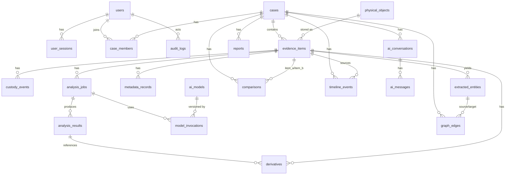

# TruthLens X — Database Design

| | |
|---|---|
| **Document ID** | TLX-DOC-003 |
| **Version** | 0.1.0 (DRAFT — pending approval) |
| **Last updated** | 2026-11-10 |
| **Engine** | PostgreSQL 16 + `pgvector` (image `pgvector/pgvector:pg16`) |
| **ORM / Migrations** | SQLAlchemy 2.1 (typed 2.0 style) · Alembic 1.20 |
| **Upstream** | [MASTER_PRD.md](./MASTER_PRD.md), [SYSTEM_ARCHITECTURE.md](./SYSTEM_ARCHITECTURE.md) |

---

## 1. Design principles

| # | Principle | Implementation |
|---|---|---|
| DB-1 | **Metadata in Postgres, bytes on disk** | No evidence blobs in the database. Only paths, hashes, sizes, and small artifacts. |
| DB-2 | **Originals referenced by content hash** | `physical_objects.sha256` is the identity; `evidence_items` are case-scoped logical references. |
| DB-3 | **Append-only for evidential tables** | `custody_events`, `audit_logs`, `model_invocations` have no UPDATE/DELETE path in the ORM and are revoked at the DB role level. |
| DB-4 | **Findings are indicators** | Every result row carries provenance, confidence, limitations, and verification columns — `NOT NULL` where honesty requires it. |
| DB-5 | **JSONB for open-shaped output, columns for queried shape** | Anything filtered/sorted/indexed is a real column; anything engine-specific and unqueried is JSONB with a documented schema. |
| DB-6 | **UTC everywhere, offsets preserved** | All `timestamptz`. Where a source timestamp has no reliable zone, the raw string is preserved in `raw_value` and precision is recorded. |
| DB-7 | **Migrations are the only schema path** | No manual DDL in any environment. Alembic autogenerate + mandatory human review + CI check that models and migrations agree. |
| DB-8 | **Least privilege at the DB role level** | Separate roles for app (DML), migrator (DDL), worker, and read-only auditor; append-only tables have `UPDATE`/`DELETE` revoked. |

### 1.1 Naming conventions

- Tables: `snake_case`, plural (`evidence_items`).
- PKs: `id uuid PRIMARY KEY`. **UUIDv7** (time-ordered, via a PL/pgSQL function added by migration) for
  high-volume append-only tables — `audit_logs`, `custody_events`, `model_invocations`,
  `integrity_checks`, `detections`, `transcript_segments`, `derivatives`, `analysis_jobs`.
  **UUIDv4** (`gen_random_uuid()`) for externally visible, long-lived entities — `users`, `cases`,
  `evidence_items`, `physical_objects`, `ai_models`, `reports`. Rationale and the information-leak
  argument: **ADR-0009**.
- FKs: `<singular_table>_id`.
- Timestamps: `created_at`, `updated_at` (`timestamptz NOT NULL DEFAULT now()`), plus domain-specific `*_at`.
- Enums: native Postgres `CREATE TYPE ... AS ENUM` for small, stable sets (they are indexed efficiently and constrain values); `CHECK` + text for sets likely to grow.
- Soft delete: `deleted_at timestamptz NULL` + partial unique indexes that exclude deleted rows.
- Money/quota: `bigint` bytes, never floats.

---

## 2. Entity–relationship overview



---

## 3. Identity, authorization & administration

### 3.1 `users`

| Column | Type | Constraints / Notes |
|---|---|---|
| `id` | uuid | PK |
| `email` | citext | UNIQUE, NOT NULL (`citext` extension for case-insensitive uniqueness) |
| `username` | citext | UNIQUE NULL (optional alternate login) |
| `full_name` | text | NOT NULL |
| `password_hash` | text | NOT NULL — argon2id encoded string (algorithm+params embedded) |
| `password_alg` | `password_alg` enum | `argon2id`, `bcrypt_legacy` — legacy rows rehash on next successful login |
| `password_changed_at` | timestamptz | NOT NULL |
| `global_role` | `global_role` enum | `admin`, `lead_investigator`, `investigator`, `analyst`, `reviewer`, `auditor` |
| `status` | `user_status` enum | `active`, `suspended`, `pending_activation`, `deactivated` |
| `mfa_enabled` | boolean | NOT NULL DEFAULT false |
| `mfa_secret_encrypted` | bytea | NULL — TOTP secret encrypted with the app KEK (never plaintext) |
| `mfa_required_by_policy` | boolean | NOT NULL DEFAULT false |
| `failed_login_count` | integer | NOT NULL DEFAULT 0 |
| `locked_until` | timestamptz | NULL |
| `last_login_at` | timestamptz | NULL |
| `last_login_ip` | inet | NULL |
| `created_at` / `updated_at` / `deleted_at` | timestamptz | `deleted_at` = soft delete (audit trail preserved) |

Indexes: `uq_users_email`, `ix_users_global_role`, partial `ix_users_active ON (email) WHERE deleted_at IS NULL`.

**Design note:** user rows are never hard-deleted. Deactivation preserves attribution for every
custody and audit record — a forensic platform that loses "who did this" is worthless.

### 3.2 `user_sessions` / refresh tokens

| Column | Type | Notes |
|---|---|---|
| `id` | uuid | PK |
| `user_id` | uuid | FK → users, ON DELETE RESTRICT |
| `refresh_token_hash` | text | UNIQUE NOT NULL — SHA-256 of the token, never the token itself |
| `family_id` | uuid | NOT NULL — enables **refresh-token rotation with reuse detection**: presenting an already-rotated token revokes the whole family |
| `issued_at` / `expires_at` / `revoked_at` | timestamptz | |
| `ip` | inet | |
| `user_agent` | text | |

Hot-path revocation checks also consult a Redis `jti` denylist for access tokens (fast, TTL-matched);
Postgres is the durable record.

### 3.2b `organisations` — inert in v1, present for tenancy-readiness (ADR-0004)

| Column | Type | Notes |
|---|---|---|
| `id` | uuid | PK |
| `name` | text | NOT NULL |
| `slug` | text | UNIQUE NOT NULL |
| `status` | text | `active` |
| `created_at` | timestamptz | |

**v1 contains exactly one seeded row** (`slug='org_default'`). It is **not read by any authorisation
logic in v1** and carries no `tenant_id` semantics. Its only purpose is to make multi-tenancy an
*additive* change later: populate real organisations → backfill `cases.organisation_id` → add one
predicate inside the single authorisation choke point → enable RLS (ADR-0010 reversal path). Per D-004,
`tenant_id`, RLS, per-tenant encryption keys and tenant quotas are **not** implemented in v1.

### 3.3 `cases`

| Column | Type | Notes |
|---|---|---|
| `id` | uuid | PK |
| `case_number` | text | UNIQUE NOT NULL, immutable after creation, format `TLX-<YYYY>-<6 digits>` (generated in a transaction against `case_number_seq`) |
| `organisation_id` | uuid | FK → organisations, NOT NULL DEFAULT the seeded `org_default` row. **Inert in v1** — see §3.2b. Present so tenancy is additive, not a rewrite. |
| `title` | text | NOT NULL |
| `description` | text | |
| `status` | `case_status` enum | `draft`, `active`, `under_review`, `closed`, `archived` |
| `sensitivity` | `sensitivity` enum | `public`, `internal`, `confidential`, `restricted` — drives download/masking policy |
| `case_type` | text | free-form taxonomy (`fraud`, `media_authenticity`, `incident`, …) |
| `jurisdiction` | text | |
| `lead_investigator_id` | uuid | FK → users |
| `opened_at` / `closed_at` | timestamptz | |
| `statutory_deadline` | timestamptz | NULL |
| `legal_hold` | boolean | NOT NULL DEFAULT true — blocks hard deletion of anything in the case |
| `storage_quota_bytes` | bigint | NULL = global default |
| `storage_used_bytes` | bigint | NOT NULL DEFAULT 0 (maintained by trigger-free service logic + periodic recount job) |
| `tags` | text[] | GIN indexed |
| `search_vector` | tsvector | generated column over title/description/tags, GIN indexed |
| `created_by` / `created_at` / `updated_at` / `deleted_at` | | |

### 3.4 `case_members` (case-level ACL)

| Column | Type | Notes |
|---|---|---|
| `case_id` | uuid | FK, part of PK |
| `user_id` | uuid | FK, part of PK |
| `case_role` | `case_role` enum | `owner`, `lead`, `member`, `contributor`, `viewer` |
| `granted_by` | uuid | FK → users, NOT NULL |
| `valid_from` / `valid_until` | timestamptz | time-bounded grants (CASE-03) |
| `capability_overrides` | text[] | NOT NULL DEFAULT '{}' — per-membership grants/revocations of the named capabilities below, applied **after** the `case_role` defaults |
| `can_view_original_content` | boolean | NOT NULL DEFAULT true — allows metadata-only membership for auditors/reviewers. Maps to the `view_evidence_content` capability. |
| `can_verify_findings` | boolean | NOT NULL DEFAULT false — maps to the `verify_finding` capability |
| `revoked_at` / `revoked_by` | | |

Unique: `(case_id, user_id)`. Index: `ix_case_members_user_active`.

**Authorisation rule (enforced in one place):** access requires an *active global role* AND an
*active case membership* within its validity window AND the specific capability bit for the action.
Deny by default; the API dependency `require_case_access(case_id, capability)` is the only supported
way to reach case-scoped data.

### 3.5 `ai_models` (model registry)

| Column | Type | Notes |
|---|---|---|
| `id` | uuid | PK |
| `family` | text | `whisper`, `yolo`, `clip`, `easyocr`, `ela`, … |
| `name` | text | exact model identifier |
| `version` | text | exact version string |
| `task` | text | `asr`, `detection`, `ocr`, `embedding`, `deepfake_indicator`, … |
| `weights_sha256` | text | NULL for algorithmic (non-weighted) engines; NOT NULL for NN models |
| `weights_path` | text | relative to the read-only model mount |
| `framework` / `framework_version` | text | e.g. `pytorch` / `2.15.0` |
| `licence` | text | SPDX id; CI gate checks against policy |
| `source_url` | text | provenance of the weights |
| `size_bytes` | bigint | |
| `min_vram_mb` | integer | NULL for CPU engines |
| `status` | `model_status` enum | `active`, `deprecated`, `retired` |
| `is_default` | boolean | partial unique index: only one default per `(family, task)` where status='active' |
| `measured_performance` | jsonb | `{dataset_name, dataset_sha256, n_samples, tpr, fpr, precision, recall, measured_at}` — **our own measurement**, never a vendor claim (AR-6) |
| `model_card_summary` | text | |
| `registered_by` / `registered_at` | | |

---

## 4. Evidence & integrity

### 4.1 `physical_objects` (the write-once store index)

| Column | Type | Notes |
|---|---|---|
| `id` | uuid | PK |
| `sha256` | char(64) | **UNIQUE NOT NULL** — the dedup key and integrity anchor |
| `sha1` | char(40) | NULL — for interoperability with external tooling |
| `md5` | char(32) | NULL — legacy interop only, never trusted |
| `size_bytes` | bigint | NOT NULL |
| `storage_backend` | text | `filesystem` \| `s3` |
| `storage_path` | text | NOT NULL, relative; never contains a user-supplied filename |
| `detected_mime` | text | NOT NULL — from **magic bytes**, not client input |
| `declared_mime` | text | what the client claimed (kept for inconsistency detection) |
| `merkle_root` | char(64) | NULL — optional per-block tree (EVID-11) |
| `block_size` | integer | NULL, with `merkle_root` |
| `encryption` | `enc_state` enum | `none`, `aes256gcm_envelope` (D-006) |
| `wrapped_dek` | bytea | NULL when `encryption='none'` |
| `av_scan_status` | text | NULL / `clean` / `infected` / `error` + `av_scan_detail jsonb` |
| `written_at` | timestamptz | NOT NULL — immutable after set |
| `first_ingested_by` | uuid | FK → users |
| `reference_count` | integer | maintained by service logic; guards against accidental physical deletion |

Trigger: `BEFORE UPDATE OR DELETE` raises an exception unless executed by the `tlx_migrator` role
with an explicit maintenance flag — enforcing write-once at the database level, not just in code.

### 4.2 `evidence_items` (case-scoped logical evidence)

| Column | Type | Notes |
|---|---|---|
| `id` | uuid | PK |
| `case_id` | uuid | FK → cases, NOT NULL |
| `physical_object_id` | uuid | FK → physical_objects, NOT NULL |
| `evidence_number` | text | NOT NULL, UNIQUE per case (`(case_id, evidence_number)`) — the human/court-facing identifier |
| `original_filename` | text | NOT NULL — preserved **verbatim as data**; never used to build a path |
| `sanitized_filename` | text | NOT NULL — for display/download naming |
| `item_type` | `evidence_type` enum | `image`, `video`, `audio`, `document`, `archive`, `text`, `other` |
| `subcategory` | text | `jpeg`, `png`, `mp4`, `pdf`, `docx`, `wav`, … |
| `status` | `evidence_status` enum | `ingesting`, `hashing`, `stored`, `analysis_pending`, `failed`, `quarantined`, `integrity_failed` |
| `integrity_status` | `integrity_status` enum | `unverified`, `verified`, `mismatch`, `missing` — NOT NULL DEFAULT `unverified` |
| `integrity_last_checked_at` | timestamptz | |
| `source_type` | `source_type` enum | `upload`, `intake_directory`, `api`, `third_party`, `extracted_child` |
| `parent_evidence_id` | uuid | NULL — self-FK for embedded/extracted children (DOC-04) |
| `submitted_by` | uuid | FK → users, NOT NULL |
| `acquired_at` | timestamptz | NULL — when the item was acquired *in the real world* (claimed) |
| `acquisition_method` | text | `seizure`, `consent`, `download`, `camera_export`, `api_pull`, … |
| `acquisition_device` | text | |
| `collection_location` | text | |
| `custody_holder_id` | uuid | FK → users — current holder |
| `notes` | text | |
| `tags` | text[] | GIN |
| `sensitivity_override` | `sensitivity` enum | NULL — may raise, never lower, above case sensitivity |
| `deleted_at` / `deleted_by` / `deletion_justification` | | soft delete only (EVID-08) |
| `created_at` / `updated_at` | | |

Indexes: `(case_id, item_type)`, `(case_id, status)`, `(physical_object_id)`, GIN on `tags`,
partial on `integrity_status` where mismatch/missing.

> **Why `evidence_items` ≠ `physical_objects`:** the same file can be submitted to two cases by two
> people with two different acquisition stories. Physically deduplicating the bytes while keeping
> independent logical records (each with its own custody chain, hashes-verified timestamps, and
> provenance) is what makes dedup safe in an evidential context.

### 4.3 `custody_events` (append-only, hash-chained)

| Column | Type | Notes |
|---|---|---|
| `id` | uuid | PK |
| `case_id` | uuid | NOT NULL — the chain is scoped per case (mitigates R-7 contention) |
| `evidence_id` | uuid | NULL for case-level events |
| `sequence` | bigint | NOT NULL, UNIQUE per case (allocated under an advisory lock) |
| `event_type` | `custody_event_type` enum | `ingested`, `hash_computed`, `hash_verified`, `accessed`, `downloaded`, `analyzed`, `verification_set`, `custody_transferred`, `custody_accepted`, `legal_hold`, `released`, `exported`, `quarantined`, `integrity_alert` |
| `actor_id` | uuid | NULL only for system jobs (then `system_actor` set) |
| `system_actor` | text | `worker-cpu-01`, `beat`, … |
| `acted_at` | timestamptz | NOT NULL |
| `sha256_at_event` | char(64) | NOT NULL — the hash believed true at that instant |
| `purpose` | text | required for content access and export |
| `ip` / `user_agent` | | |
| `request_id` | text | correlates to app logs |
| `recipient_id` | uuid | NULL — for transfers |
| `detail` | jsonb | event-specific payload (pipeline id, byte range, URL expiry…) |
| `prev_hash` | char(64) | NOT NULL (genesis = 64 zero chars) |
| `record_hash` | char(64) | NOT NULL — `sha256(canonical_json(all fields above))` |

`record_hash` is computed over a **canonical JSON** serialisation (sorted keys, no whitespace,
fixed timestamp format, `null` preserved) so verification is reproducible across implementations.
The canonicalisation routine is unit-tested with golden vectors.

Permissions: `UPDATE`/`DELETE` **revoked** from the app role; verified by a migration test.

### 4.4 `derivatives`

| Column | Type | Notes |
|---|---|---|
| `id` | uuid | PK |
| `evidence_id` | uuid | FK, NOT NULL (NULL allowed for case-level artifacts like reports → then `case_id` set) |
| `case_id` | uuid | NOT NULL |
| `kind` | `derivative_kind` enum | `thumbnail`, `frame`, `heatmap`, `overlay`, `transcript`, `spectrogram`, `waveform`, `extracted_audio`, `extracted_file`, `report_pdf`, `graph_image`, `annotation`, `masked_preview` |
| `path` | text | NOT NULL, under `derivatives/` |
| `sha256` | char(64) | NOT NULL |
| `size_bytes` | bigint | |
| `mime` | text | |
| `produced_by_job_id` | uuid | FK → analysis_jobs, NULL for manual annotations |
| `engine_id` / `engine_version` | text | reproducibility |
| `params` | jsonb | exact generation parameters |
| `frame_index` / `pts_seconds` | int / numeric | for video frames |
| `status` | `artifact_status` enum | `available`, `stale`, `purged`, `failed` |
| `created_at` | | |

Unique: `(evidence_id, kind, engine_version, params_hash)` — prevents duplicate artifacts on retry.
`stale` marks artifacts whose engine version changed; a reindex job regenerates or purges them.

---

## 5. Analysis, findings & provenance

### 5.1 `analysis_jobs`

| Column | Type | Notes |
|---|---|---|
| `id` | uuid | PK |
| `case_id` / `evidence_id` | uuid | evidence_id NULL for case-wide jobs (bulk compare, reindex) |
| `pipeline` | text | NOT NULL — `image.ela`, `image.dqt`, `doc.revisions`, `video.detect_track`, `deepfake.indicators`, `audio.asr`, … |
| `pipeline_version` | text | NOT NULL |
| `params` | jsonb | NOT NULL DEFAULT '{}' |
| `params_hash` | char(64) | generated/stored for idempotency keys |
| `priority` | smallint | NOT NULL DEFAULT 5 |
| `queue` | text | `analysis.cpu` \| `analysis.gpu` \| `ingest` \| `reports` \| `maintenance` |
| `status` | `job_status` enum | `queued`, `running`, `succeeded`, `failed`, `cancelled`, `retrying`, `dead_letter` |
| `celery_task_id` | text | |
| `idempotency_key` | text | UNIQUE — `(evidence_id, pipeline, params_hash)` |
| `requested_by` | uuid | FK → users, NULL for scheduled jobs |
| `worker_id` | text | |
| `attempt` | smallint | NOT NULL DEFAULT 0 |
| `queued_at` / `started_at` / `finished_at` | timestamptz | |
| `progress_pct` | smallint | 0–100 |
| `progress_message` | text | |
| `error_class` | text | `MODEL_UNAVAILABLE`, `OOM`, `DECODE_FAILED`, `UNSUPPORTED_FORMAT`, `TIMEOUT`, `INTEGRITY_MISMATCH`, `INTERNAL` |
| `error_detail` | jsonb | sanitised — never contains file contents or secrets |
| `duration_ms` | integer | |
| `resource_stats` | jsonb | peak RSS, GPU util, frames processed |

Indexes: `(case_id, status)`, `(queue, status, priority)`, `(status)` partial for `running`.

### 5.2 `analysis_results` — **the honesty-critical table**

| Column | Type | Notes |
|---|---|---|
| `id` | uuid | PK |
| `job_id` | uuid | FK → analysis_jobs, NOT NULL |
| `case_id` / `evidence_id` | uuid | NOT NULL / NOT NULL (NULL for case-level) |
| `pipeline` / `pipeline_version` | text | NOT NULL |
| `result_kind` | text | `ela_heatmap`, `dqt_match`, `transcript`, `detection_set`, `deepfake_advisory`, `metadata`, `comparison`, … |
| `summary` | text | NOT NULL — human-readable, indicator-framed (AR-1) |
| `indicators` | jsonb | NOT NULL — array of `{code, label, value, unit, confidence, region, interpretation}` |
| `advisory_score` | numeric(5,2) | NULL — 0–100 where meaningful; NULL is honest when it isn't (AR-3) |
| `score_confidence_low` / `_high` | numeric(5,2) | NULL — interval, mandatory whenever `advisory_score` is set |
| `confidence` | numeric(5,4) | NULL — 0–1 where the engine produces a calibrated value |
| `confidence_basis` | text | NULL — `model_softmax`, `heuristic_threshold`, `statistical_test`, `not_applicable`; **required when `confidence` is set** |
| `limitations_code` | text | NOT NULL — FK-ish to `limitation_statements.code` (AR-4) |
| `requires_human_verification` | boolean | NOT NULL DEFAULT true — cannot be set false by any engine |
| `verification_status` | `verification_status` enum | `unverified`, `confirmed`, `rejected`, `inconclusive` — NOT NULL DEFAULT `unverified` |
| `verified_by` | uuid | FK → users, NULL until verified |
| `verified_at` | timestamptz | NULL |
| `verification_notes` | text | NULL — **required by CHECK when status ∈ (confirmed, rejected)** |
| `supersedes_id` | uuid | NULL — self-FK when a re-run replaces an earlier result |
| `is_current` | boolean | NOT NULL DEFAULT true |
| `region_ref` | jsonb | NULL — bbox/polygon/timecode the result pertains to |
| `derivative_ids` | uuid[] | artifacts illustrating this result |
| `raw_output` | jsonb | full engine output (schema-versioned) for re-interpretation |
| `raw_output_schema_version` | text | NOT NULL |
| `created_at` | | |

Constraints worth calling out (enforced in Postgres, so no code path can bypass them):

```sql
CHECK (advisory_score IS NULL
       OR (score_confidence_low IS NOT NULL AND score_confidence_high IS NOT NULL))
CHECK (confidence IS NULL OR confidence_basis IS NOT NULL)
CHECK (verification_status NOT IN ('confirmed','rejected') OR verification_notes IS NOT NULL)
CHECK (verification_status <> 'unverified' OR verified_by IS NULL)
```

Indexes: `(case_id, result_kind, is_current)`, `(evidence_id, is_current)`,
`(verification_status) WHERE verification_status='unverified'` (the verification backlog query),
GIN on `indicators`.

### 5.3 `limitation_statements` (versioned, so reports stay truthful retroactively)

| Column | Type | Notes |
|---|---|---|
| `code` | text | PK part — `ELA`, `DEEPFAKE`, `ALPR`, `ASR`, `DQT`, `COPY_MOVE`, `GEO_PLAUSIBILITY`, … |
| `version` | integer | PK part |
| `text_en` | text | NOT NULL — the exact disclaimer rendered in UI and reports |
| `effective_from` / `effective_to` | timestamptz | |
| `approved_by` | uuid | |

`analysis_results.limitations_code` + the `pipeline_version` resolve to the statement text **in
force at result creation**; a `result_limitation_snapshot` column stores the resolved text so a
report generated years later prints what was true then, not what is true now.

### 5.4 `model_invocations` (append-only, AR-2)

| Column | Type | Notes |
|---|---|---|
| `id` | uuid | PK |
| `job_id` | uuid | NOT NULL |
| `result_id` | uuid | NULL |
| `ai_model_id` | uuid | FK → ai_models, NOT NULL |
| `model_name` / `model_version` / `weights_sha256` | text | **denormalised snapshot** — survives registry edits |
| `framework` / `framework_version` | text | |
| `engine_name` / `engine_version` | text | |
| `library_versions` | jsonb | `{opencv, torch, numpy, easyocr, whisper, ffmpeg, exiftool, pikepdf, ...}` |
| `device` | text | `cpu`, `cuda:0` |
| `params` | jsonb | thresholds, batch size, sample rate, beam size, confidence cutoff |
| `seed` | bigint | NULL where not applicable |
| `deterministic` | boolean | NOT NULL |
| `started_at` / `finished_at` / `duration_ms` | | |
| `peak_memory_mb` | integer | |
| `status` | `invocation_status` enum | `succeeded`, `failed`, `partial` |
| `error_class` | text | |

### 5.5 `metadata_records`

| Column | Type | Notes |
|---|---|---|
| `id` | uuid | PK |
| `evidence_id` | uuid | FK, NOT NULL |
| `extractor` | text | `exiftool`, `pymupdf`, `pikepdf`, `ffprobe`, `pillow`, `pure_python` |
| `extractor_version` | text | NOT NULL |
| `invocation_args` | jsonb | NOT NULL — reproducibility (META-06) |
| `raw_tags` | jsonb | NOT NULL — complete tag dump |
| `normalised` | jsonb | curated common schema (see §5.6) |
| `extraction_job_id` | uuid | FK |
| `stripping_signals` | jsonb | `{missing_camera_make: true, uniform_timestamps: false, editor_software: "..."}` |
| `extracted_at` | | |

Unique: `(evidence_id, extractor, extractor_version)`.

### 5.6 `normalised` JSONB contract

```jsonc
{
  "schema_version": "1.0",
  "dimensions": {"width": 4032, "height": 3024, "unit": "px"},
  "duration_seconds": null,
  "device": {"make": "Apple", "model": "iPhone 13", "serial": null, "lens": null},
  "software": {"creator": "15.1", "editor": null, "encoder_tag": null},
  "author": {"name": null, "org": null},
  "timestamps": [
    {"field": "DateTimeOriginal", "raw_value": "2026:03:14 18:22:07",
     "utc": "2026-03-14T13:22:07Z", "original_offset": "+05:00",
     "provenance": "device_clock", "reliability": "medium", "precision": "second"}
  ],
  "location": {"latitude": 30.1234, "longitude": 71.4456, "datum": "WGS84",
               "altitude_m": 213.0, "precision_digits": 4,
               "uncertainty_radius_m": 11.0, "source": "exif_gps"},
  "encoding": {"mime": "image/jpeg", "codec": null, "bitrate": null,
               "sample_rate": null, "channels": null, "bit_depth": null},
  "integrity_hints": {"jpeg_quality_estimate": 87, "dqt_signature": "apple_heic_transcode",
                      "double_compression": false, "re_encode_likelihood": "high"}
}
```

Timestamp `provenance` ∈ `device_clock | container | filesystem | embedded_xmp | server_supplied |
analyst_asserted`; `reliability` ∈ `high | medium | low | unknown`. **Conflicting timestamps are
all retained** (TIME-03) — the array is never collapsed to one value.

### 5.7 `extracted_entities`

| Column | Type | Notes |
|---|---|---|
| `id` | uuid | PK |
| `case_id` / `evidence_id` | uuid | NOT NULL |
| `entity_type` | `entity_type` enum | `person_candidate`, `face_cluster`, `vehicle_plate_candidate`, `location`, `device`, `document_subject`, `phone_number`, `organisation`, `event`, `object_instance` |
| `value` | text | NOT NULL — normalised value (plate string, coordinate string, name) |
| `value_hash` | char(64) | NOT NULL — for grouping without leaking values into indexes unnecessarily |
| `display_value` | text | may be masked per role (GEO-07, ALPR-07) |
| `confidence` | numeric(5,4) | NULL |
| `alternatives` | jsonb | top-N candidates with per-item confidence (ALPR-04) |
| `region_ref` | jsonb | bbox / timecode / page / span |
| `source_job_id` | uuid | |
| `origin` | `edge_origin` enum | `extracted`, `manual`, `inferred` |
| `verified_status` | `verification_status` enum | defaults `unverified` |
| `first_seen_at` / `last_seen_at` | timestamptz | |

Indexes: `(case_id, entity_type)`, `(entity_type, value_hash)` (cross-evidence linking), GIN on `alternatives`.

> **`person_candidate` and `vehicle_plate_candidate` are deliberately named as candidates.** The
> naming is part of the honesty policy: these are detected clusters, not identified people or
> registered vehicles (AR-8, ALPR-06).

---

## 6. Comparison, graph, timeline

### 6.1 `comparisons`

| Column | Type | Notes |
|---|---|---|
| `id` | uuid | PK |
| `case_id` | uuid | NOT NULL |
| `item_a_id` / `item_b_id` | uuid | FK → evidence_items, NOT NULL, `CHECK (item_a_id <> item_b_id)` |
| `method` | text | `exact_hash`, `phash`, `feature_match`, `histogram`, `template_match`, `embedding_cosine`, `metadata_diff`, `audio_xcorr`, `text_diff` |
| `method_version` | text | NOT NULL |
| `params` | jsonb | NOT NULL |
| `score` | numeric(12,6) | NOT NULL — raw metric (Hamming distance, inlier count, cosine…) |
| `score_unit` | text | NOT NULL — `hamming_bits`, `inliers`, `cosine`, `normalised_correlation` |
| `similarity_band` | `similarity_band` enum | `identical`, `very_high`, `high`, `moderate`, `low`, `unrelated` — band thresholds are versioned config |
| `interpretation` | text | NOT NULL — what the score does and does not imply |
| `limitations_code` / `limitations_snapshot` | text / text | NOT NULL |
| `regions` | jsonb | matched region pairs, homography matrix, inlier map path |
| `derivative_ids` | uuid[] | difference heatmaps, overlay images |
| `job_id` | uuid | NULL for synchronous small comparisons |
| `verification_status` / `verified_by` / `verified_at` / `verification_notes` | | same CHECKs as `analysis_results` |
| `requested_by` / `created_at` | | |

### 6.2 `graph_edges`

| Column | Type | Notes |
|---|---|---|
| `id` | uuid | PK |
| `case_id` | uuid | NOT NULL |
| `source_type` / `source_id` | text / uuid | polymorphic endpoint (evidence, extracted_entity, timeline_event) |
| `target_type` / `target_id` | text / uuid | |
| `relation` | text | `same_bytes`, `visually_similar`, `same_location`, `same_device`, `same_plate`, `same_face_cluster`, `mentions`, `contains`, `extracted_from`, `temporally_adjacent`, `manual_note` |
| `origin` | `edge_origin` enum | `manual`, `inferred`, `system` |
| `confidence` | numeric(5,4) | NOT NULL when `origin='inferred'` (CHECK) |
| `produced_by_rule` / `rule_version` | text | NOT NULL when inferred |
| `produced_by_job_id` | uuid | |
| `weight` | numeric(8,4) | for path ranking |
| `directed` | boolean | NOT NULL DEFAULT true |
| `verification_status` / `verified_by` / `verified_at` / `rejected_reason` | | GRAPH-04 |
| `annotation` | text | analyst note |
| `created_at` | | |

Unique: `(case_id, source_type, source_id, target_type, target_id, relation, rule_version)` —
idempotent re-runs don't multiply edges. Indexes on both endpoints and `(case_id, relation, confidence)`.

`graph_nodes` is a **materialised view** over `evidence_items` + `extracted_entities` +
`timeline_events`, refreshed by a job; node *styling/pinning* state lives in `graph_node_state`.

### 6.3 `timeline_events`

| Column | Type | Notes |
|---|---|---|
| `id` | uuid | PK |
| `case_id` | uuid | NOT NULL |
| `evidence_id` | uuid | NULL for analyst-asserted case events |
| `occurred_at` | timestamptz | NOT NULL |
| `occurred_at_precision` | `time_precision` enum | `exact`, `second`, `minute`, `hour`, `day`, `month`, `year` |
| `occurred_at_raw` | text | NOT NULL — original string as found (e.g. `2026:03:14 18:22:07`) |
| `timezone_raw` | text | as found; NULL if absent |
| `timezone_confidence` | `reliability` enum | `high/medium/low/unknown` |
| `derivation` | `time_derivation` enum | `device_claimed`, `filesystem`, `container`, `embedded_xmp`, `server_supplied`, `transcript`, `gps_track`, `analysis_completion`, `analyst_asserted`, `inferred` |
| `reliability` | `reliability` enum | NOT NULL |
| `corroborated` | boolean | NOT NULL DEFAULT false — set only when an independent source agrees (TIME-03) |
| `corroborated_by_event_ids` | uuid[] | |
| `conflict_group_id` | uuid | NULL — groups competing timestamps for the same logical event; **never merged** |
| `event_type` | text | `capture`, `edit`, `transfer`, `mention`, `detection`, `movement`, `communication`, `analyst_note`, `system` |
| `title` / `description` | text | |
| `entities` | uuid[] | related `extracted_entities` |
| `location_ref` | jsonb | NULL |
| `source_job_id` | uuid | |
| `created_by` / `created_at` / `updated_at` | | |

Indexes: `(case_id, occurred_at)` — the primary timeline query; `(conflict_group_id)`;
`(case_id, derivation)`; BRIN on `occurred_at` for very large cases.

---

## 7. Similarity search & embeddings

### 7.1 `evidence_embeddings`

| Column | Type | Notes |
|---|---|---|
| `id` | uuid | PK |
| `evidence_id` | uuid | FK, NOT NULL |
| `case_id` | uuid | NOT NULL — **every vector query is case-scoped by predicate** (no cross-case leakage) |
| `modality` | `modality` enum | `image`, `video_frame`, `audio`, `text`, `document` |
| `model_id` | uuid | FK → ai_models, NOT NULL |
| `model_version` | text | NOT NULL — denormalised for versioned vector sets (SIM-05) |
| `vector_set` | text | NOT NULL — `<model_family>-<version>`; enables parallel sets during migration |
| `embedding` | vector(512) | NOT NULL — dimension fixed per `vector_set`; CHECK on dim via trigger for mixed sets |
| `chunk_ref` | jsonb | NULL — frame index / page / timecode span the vector represents |
| `norm` | numeric(12,8) | precomputed for cosine |
| `created_at` | | |

Indexes:
```sql
CREATE INDEX ix_emb_hnsw ON evidence_embeddings
  USING hnsw (embedding vector_cosine_ops) WITH (m = 16, ef_construction = 128);
CREATE INDEX ix_emb_scope ON evidence_embeddings (case_id, vector_set, modality);
```

**Hybrid search rule:** the `case_id` + `vector_set` predicate is always applied; HNSW recall is
spot-checked against brute force on a sample set as a CI gate (SIM-06). If two model versions are
live during migration, queries pin one `vector_set` — mixing sets in a single similarity ranking is
invalid and blocked by a CHECK on the query builder.

### 7.2 `perceptual_hashes` (cheap, deterministic, index-friendly)

| Column | Type | Notes |
|---|---|---|
| `evidence_id` | uuid | PK part |
| `algorithm` | text | PK part — `phash`, `dhash`, `ahash`, `whash` |
| `hash_bits` | bit(64) | NOT NULL — enables index-assisted Hamming lookups |
| `hash_hex` | char(16) | NOT NULL |
| `variant` | text | PK part — e.g. `phash@32x32`, grayscale/colour |
| `engine_version` | text | |
| `computed_at` | | |

Near-duplicate search uses a bucketed-band technique (split 64 bits into 4×16-bit bands, index each)
so candidates are found without a full scan; exact Hamming distance is then computed on candidates.

---

## 8. Reports, assistant, audit

### 8.1 `reports`

| Column | Type | Notes |
|---|---|---|
| `id` | uuid | PK |
| `case_id` | uuid | NOT NULL |
| `template` | text | `full_investigation`, `evidence_summary`, `custody_only`, `deepfake_advisory`, `custom` |
| `version` | integer | NOT NULL, UNIQUE per `(case_id, title-slug)` lineage |
| `lineage_id` | uuid | NOT NULL — groups regenerated versions |
| `title` | text | |
| `status` | `report_status` enum | `generating`, `draft`, `final`, `superseded`, `failed` |
| `watermark` | text | `DRAFT`, `FINAL`, `COPY n OF m` |
| `classification_banner` | text | from case sensitivity |
| `manifest` | jsonb | NOT NULL — `{entity_type, entity_id, content_hash}` for every source entity + selected sections + filters (RPT-04) |
| `manifest_hash` | char(64) | NOT NULL — hash of canonical manifest; same manifest → same report content |
| `pdf_derivative_id` | uuid | FK → derivatives |
| `pdf_sha256` | char(64) | NOT NULL |
| `generated_by` / `generated_at` | | |
| `approved_by` / `approved_at` | | NULL until a lead marks FINAL |
| `signature_block` | jsonb | examiner attestation data |
| `crypto_signature` | jsonb | NULL — optional PDF signing metadata (RPT-06) |
| `job_id` | uuid | |
| `engine_versions` | jsonb | ReportLab + template versions (reproducibility) |

### 8.2 `ai_conversations` / `ai_messages` (AI-04)

`ai_conversations`: `id`, `case_id`, `title`, `created_by`, `provider` (`local_ollama`,
`vllm`, `external_api`), `model_id` FK, `status`, `created_at`.

`ai_messages`:

| Column | Type | Notes |
|---|---|---|
| `id` | uuid | PK |
| `conversation_id` | uuid | FK, NOT NULL |
| `role` | `chat_role` enum | `system`, `user`, `assistant`, `tool` |
| `content` | text | NOT NULL |
| `citations` | jsonb | NOT NULL DEFAULT '[]' — `[{entity_type, entity_id, snippet, score}]`; assistant messages with empty citations must set `unsupported=true` (AI-02) |
| `unsupported` | boolean | NOT NULL DEFAULT false |
| `retrieval_context` | jsonb | what was actually retrieved (chunk ids + scores) |
| `prompt_tokens` / `completion_tokens` | integer | |
| `model_name` / `model_version` | text | snapshot |
| `temperature` / `top_p` / `seed` | numeric/bigint | |
| `guardrail_version` | text | NOT NULL — the system-prompt/guardrail revision in force |
| `latency_ms` | integer | |
| `status` | enum | `succeeded`, `failed`, `refused` |
| `created_at` | | |

CHECK: `role <> 'assistant' OR cardinality(citations) > 0 OR unsupported = true`. The assistant
literally cannot persist an uncited claim without declaring itself unsupported.

### 8.3 `audit_logs` (append-only, hash-chained)

Same shape as `custody_events` but platform-wide and action-oriented:

`id`, `sequence bigint UNIQUE`, `occurred_at`, `actor_id`, `actor_role`, `actor_ip`, `user_agent`,
`action text` (namespaced: `auth.login.failed`, `case.status.changed`, `evidence.created`,
`evidence.original.accessed`, `analysis.job.created`, `result.verification.set`, `report.generated`,
`admin.user.role.changed`, `config.changed`), `resource_type`, `resource_id`, `case_id`,
`result enum ('success','failure','denied')`, `reason`, `request_id`, `before jsonb`, `after jsonb`,
`metadata jsonb`, `prev_hash char(64)`, `record_hash char(64)`.

Partitioning: `PARTITION BY RANGE (occurred_at)` monthly. Indexes: `(occurred_at)`,
`(actor_id, occurred_at)`, `(case_id, occurred_at)`, `(action, occurred_at)`, `(resource_type, resource_id)`.

`before`/`after` are **redacted snapshots** — never secrets, never full evidence content, and PII
minimised. The redaction allowlist is code-reviewed and unit-tested.

### 8.4 Supporting tables

| Table | Purpose | Key columns |
|---|---|---|
| `annotations` | analyst regions/notes on derivatives (IMG-09) | `evidence_id`, `derivative_id`, `geometry jsonb`, `body text`, `version`, `created_by`, `superseded_by` |
| `detections` | per-detection rows for queryability (OBJ-03) | `evidence_id`, `frame_index`, `pts_seconds`, `class`, `confidence`, `bbox`, `track_id`, `job_id` |
| `tracks` | aggregated MOT tracks (OBJ-06) | `evidence_id`, `track_id`, `class_vote`, `first_pts`, `last_pts`, `path jsonb`, `occlusion_segments jsonb` |
| `transcript_segments` | word/speaker-timed segments (AUD-07) | `evidence_id`, `job_id`, `seq`, `speaker_label`, `start_ms`, `end_ms`, `text`, `word_confidence`, `language`, `language_probability` |
| `plate_occurrences` | ALPR groupings (ALPR-05) | `entity_id`, `value`, `alternatives jsonb`, `confidence`, `format_matched`, `jurisdiction_format_id` |
| `plate_formats` | versioned per-jurisdiction validators (ALPR-03) | `code`, `jurisdiction`, `regex`, `description`, `version`, `active` |
| `locations` | normalised geo points (GEO-02) | `evidence_id`, `latitude`, `longitude`, `altitude_m`, `uncertainty_m`, `precision_digits`, `geohash`, `gazetteer_match jsonb` |
| `movement_tracks` | ordered GPS tracks (GEO-04) | `case_id`, `entity_id`, `points jsonb`, `implausible_segments jsonb` |
| `integrity_checks` | sweep results (EVID-07) | `physical_object_id`, `checked_at`, `expected_sha256`, `actual_sha256`, `result`, `job_id` |
| `retention_policies` | configurable lifecycle (AUD-06) | `scope`, `evidence_type`, `keep_until_event`, `keep_duration`, `action`, `approved_by` |
| `system_settings` | curated runtime-adjustable config (ADM-06) | `key UNIQUE`, `value jsonb`, `schema jsonb`, `updated_by`, `updated_at`, `previous_value jsonb` |
| `feature_flags` | licence/rollout flags | `key UNIQUE`, `enabled`, `reason`, `updated_by` |
| `notifications` | verification backlog / integrity alerts | `user_id`, `case_id`, `kind`, `payload jsonb`, `read_at` |

---

## 9. Enums (canonical list)

```sql
CREATE TYPE global_role         AS ENUM ('admin','lead_investigator','investigator','analyst','reviewer','auditor');
CREATE TYPE case_role           AS ENUM ('owner','lead','member','contributor','viewer');
CREATE TYPE user_status         AS ENUM ('pending_activation','active','suspended','deactivated');
CREATE TYPE password_alg        AS ENUM ('argon2id','bcrypt_legacy');
CREATE TYPE case_status         AS ENUM ('draft','active','under_review','closed','archived');
CREATE TYPE sensitivity         AS ENUM ('public','internal','confidential','restricted');
CREATE TYPE evidence_type       AS ENUM ('image','video','audio','document','archive','text','other');
CREATE TYPE evidence_status     AS ENUM ('ingesting','hashing','stored','analysis_pending','failed','quarantined','integrity_failed');
CREATE TYPE integrity_status    AS ENUM ('unverified','verified','mismatch','missing');
CREATE TYPE source_type         AS ENUM ('upload','intake_directory','api','third_party','extracted_child');
CREATE TYPE custody_event_type  AS ENUM ('ingested','hash_computed','hash_verified','accessed','downloaded','analyzed',
                                         'verification_set','custody_transferred','custody_accepted','legal_hold',
                                         'released','exported','quarantined','integrity_alert');
CREATE TYPE verification_status AS ENUM ('unverified','confirmed','rejected','inconclusive');
CREATE TYPE job_status          AS ENUM ('queued','running','succeeded','failed','cancelled','retrying','dead_letter');
CREATE TYPE derivative_kind     AS ENUM ('thumbnail','frame','heatmap','overlay','transcript','spectrogram','waveform',
                                         'extracted_audio','extracted_file','report_pdf','graph_image','annotation','masked_preview');
CREATE TYPE artifact_status     AS ENUM ('available','stale','purged','failed');
CREATE TYPE entity_type         AS ENUM ('person_candidate','face_cluster','vehicle_plate_candidate','location','device',
                                         'document_subject','phone_number','organisation','event','object_instance');
CREATE TYPE edge_origin         AS ENUM ('manual','inferred','system','extracted');
CREATE TYPE similarity_band     AS ENUM ('identical','very_high','high','moderate','low','unrelated');
CREATE TYPE time_precision      AS ENUM ('exact','second','minute','hour','day','month','year');
CREATE TYPE reliability         AS ENUM ('high','medium','low','unknown');
CREATE TYPE time_derivation     AS ENUM ('device_claimed','filesystem','container','embedded_xmp','server_supplied',
                                         'transcript','gps_track','analysis_completion','analyst_asserted','inferred');
CREATE TYPE modality            AS ENUM ('image','video_frame','audio','text','document');
CREATE TYPE model_status        AS ENUM ('active','deprecated','retired');
CREATE TYPE report_status       AS ENUM ('generating','draft','final','superseded','failed');
CREATE TYPE chat_role           AS ENUM ('system','user','assistant','tool');
CREATE TYPE enc_state           AS ENUM ('none','aes256gcm_envelope');
CREATE TYPE invocation_status   AS ENUM ('succeeded','failed','partial');
```

Alembic note: Postgres cannot remove an enum value. Adding values is migration-safe; **removing**
one requires a type-rebuild migration with an explicit data path. That asymmetry is why growing sets
(e.g. `relation`, `pipeline`, `entity_type` subtypes) are `text` + CHECK/lookup tables instead of enums.

---

## 10. Indexing, partitioning & performance

| Concern | Approach |
|---|---|
| Hot read path | `(case_id, …)` composite indexes on every case-scoped table; **case_id is the leading column in 90% of queries** because ACL scoping always applies it. |
| Verification backlog | Partial index on `analysis_results (case_id) WHERE verification_status='unverified' AND is_current`. |
| Timeline | `(case_id, occurred_at)` + BRIN for very large ranges. |
| Full-text | `tsvector` generated columns + GIN on `cases`, `evidence_items`, `extracted_entities.display_value`. |
| Vectors | HNSW (`m=16`, `ef_construction=128`), tuned by measured recall at M11; `hnsw.ef_search` set per query. |
| Audit growth | `audit_logs` and `custody_events` RANGE-partitioned monthly; `detections`/`transcript_segments` partitioned by `case_id` hash when a case exceeds 5M rows. |
| Integrity checks | Append-only, partitioned monthly, rolled to cold storage after 24 months. |
| Connection pool | PgBouncer (transaction mode) in front of Postgres for API + workers; pool sizes per service in `.env.example`. |
| Slow queries | `pg_stat_statements` enabled; `auto_explain` for > 2 s in staging; review is a milestone exit criterion. |
| Read scaling | Read replica optional in phase 2; repository layer already routes reads through a single session factory to make that a config change. |

---

## 11. Migration strategy (Alembic)

1. **One logical change per revision.** Autogenerate, then hand-review: autogenerate misses enum
   changes, CHECK constraints, partitioning, extensions, grants, and index concurrency.
2. **Never** `DROP TABLE`/`DROP COLUMN` in the same release that stops writing it. Two-phase: stop
   writing → verify → drop (each its own revision, each reviewed).
3. **Data migrations are explicit** (`op.execute`) and idempotent, with a `--dry-run` reporting mode.
4. **Backwards-compatible deploy order**: expand → migrate code → contract. The API must run against
   both N and N+1 schemas during rollout.
5. **CI gate**: `alembic upgrade head` on an empty DB, then `alembic check` (models vs migrations
   drift), then downgrade one step and re-upgrade.
6. **Seeds**: `limitation_statements`, `plate_formats`, `ai_models` catalogue, and RBAC matrix rows
   are seeded by versioned data migrations — not by ad-hoc scripts — so every environment is identical.
7. **DDL role separation**: migrations run as `tlx_migrator`; the app role `tlx_app` has DML only;
   `tlx_auditor` is read-only; append-only tables have `UPDATE`/`DELETE` revoked from `tlx_app`.
8. **Post-migration smoke**: after `upgrade head`, run a health query set (row counts on seeded
   tables, one write/read round-trip in a throwaway transaction that is rolled back).

---

## 12. Retention & deletion

| Data | Retention | Deletion path |
|---|---|---|
| Originals | Case lifetime + statutory period; `legal_hold` blocks deletion | Requires `admin` + justification + second approver + audit record; physical delete only when `reference_count = 0` |
| Derivatives | Regenerable; purged on policy or when stale | Automated, no approval (but logged) |
| Analysis results | Case lifetime; superseded rows retained with `is_current=false` | Never deleted while the case is held |
| Custody/audit | **Outlives the case**; archived to cold storage | Never deleted in v1; archival only |
| Embeddings | Follows evidence; purged with the derivative set | Automated |
| User PII | Deactivated, not erased, while cases reference the user; erasure on documented legal request with an audit trail | `admin` + documented procedure |

---

## 13. Reference data seeded at migration time

- `limitation_statements` — the AR-4 disclaimer corpus, versioned.
- `plate_formats` — jurisdiction validators, **empty of assumptions by default**; the deployment must
  configure its own (ALPR-03). A starter set is provided as *examples* clearly marked `is_example=true`.
- `dqt_signatures` — reference quantisation tables for known cameras/encoders (source + licence noted per row).
- `relation_types`, `pipeline_catalogue` — typed vocabularies so the graph/pipeline fields stay constrained without brittle enums.
- `rbac_matrix` — role × capability rows consumed by the authorisation service (SECURITY_ARCHITECTURE §4).
- `capabilities` — the canonical capability vocabulary (ADR-0004). Each row is `code`, `description`,
  `scope` (`case` | `platform`), `sensitive` (bool), `audit_always` (bool). The v1 set:
  `view_case`, `edit_case`, `close_case`, `reopen_case`, `manage_members`, `upload_evidence`,
  `view_evidence`, `view_evidence_content`, `edit_evidence_metadata`, `delete_evidence`,
  `hard_delete_evidence`, `analyze_evidence`, `view_finding`, `verify_finding`, `create_comparison`,
  `create_graph_edge`, `verify_graph_edge`, `create_timeline_event`, `use_assistant`,
  `export_reports`, `generate_report`, `approve_report`, `read_audit`, `verify_audit_chain`,
  `manage_users`, `manage_models`, `manage_settings`, `manage_queues`, `break_glass`,
  `enable_external_ai`.
- `ai_external_grants` — one row per approved external-AI enablement (ADR-0007 §4.2):
  `id`, `enabled_by`, `justification` (NOT NULL), `acknowledged_disclosure` (bool, NOT NULL),
  `enabled_at`, `expires_at` (NOT NULL, ≤ `enabled_at + 30 days`), `revoked_at`, `revoked_by`,
  `allowed_categories text[]`, `status`. Expiry is enforced by a beat job; there is no permanent grant.

  `CHECK (expires_at <= enabled_at + interval '30 days')` — the time bound is a database constraint,
  not an application convention.

---

*End of DATABASE_DESIGN.md — v0.1.0 DRAFT. No tables exist yet; the first migration lands in
milestone M1 (see [IMPLEMENTATION_ROADMAP.md](./IMPLEMENTATION_ROADMAP.md)).*
