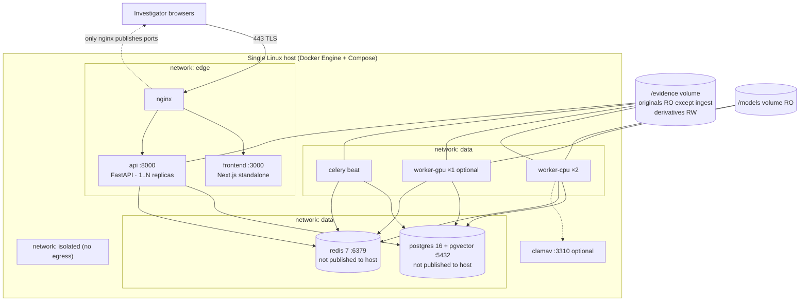

# TruthLens X — Deployment Guide

| | |
|---|---|
| **Document ID** | TLX-DOC-008 |
| **Version** | 0.1.0 (DRAFT — pending approval) |
| **Last updated** | 2026-11-10 |
| **Primary target** | Docker Compose on a single Linux host (x86_64), optional NVIDIA GPU |
| **Secondary target** | Kubernetes + Helm (phase 2, scaffolded not delivered in v1) |
| **Related** | [SYSTEM_ARCHITECTURE.md](./SYSTEM_ARCHITECTURE.md) §11, [SECURITY_ARCHITECTURE.md](./SECURITY_ARCHITECTURE.md) §5.5 |

> ⚠️ **Status:** this is the *design* of the deployment. Nothing is deployable yet — the compose
> files, Dockerfiles and scripts described here are delivered in **M1** and hardened through **M20**.
> This document is written first so that the deployment target constrains the architecture rather
> than the reverse.

---

## 1. Topology



**Port exposure rule:** only nginx publishes `80/443`. Postgres, Redis, the API, workers, and
`/metrics` are reachable only on internal Docker networks. If you need direct DB access for
maintenance, use `docker compose exec` — never publish the port.

---

## 2. Host requirements

| Tier | CPU | RAM | Disk | GPU | Suits |
|---|---|---|---|---|---|
| **Minimum (dev/eval)** | 4 vCPU | 8 GB | 100 GB SSD | none | Exploration; CPU-only engines on small fixtures; slow ASR |
| **Recommended (small team)** | 16 vCPU | 64 GB | 2 TB NVMe (+ evidence storage) | 1× RTX 4090 / A4000 (16–24 GB) | 5–10 concurrent investigators, modest video work |
| **Production (serious caseload)** | 32+ vCPU | 128 GB+ | 8 TB+ NVMe, RAID/ECC, separate evidence volume | 1–2× A100/L4 (24–48 GB) | 200 active cases, 1M items, GPU pipelines at throughput |

Other host requirements:

- **OS:** Ubuntu 22.04/24.04 LTS or Debian 12 (other distros work; runbooks assume apt).
- **Docker Engine** ≥ 24, **Compose plugin** ≥ 2.20, **NVIDIA Container Toolkit** for GPU.
- **Time sync:** chrony/`systemd-timesyncd` with a reliable NTP source. *Timestamps are evidence*;
  clock drift corrupts timelines and audit credibility.
- **Filesystem:** XFS or ext4 for `/evidence`. XFS preferred for very large files and many inodes.
  Note: `chattr +i` immutability works on ext4/XFS — recommended for `originals/` (SECURITY T-01).
- **Kernel:** seccomp + user namespaces available; `fs.inotify.max_user_watches` raised if using the
  intake watcher; `vm.max_map_count ≥ 262144` for Postgres with large shared buffers.
- **Disk headroom:** never let `/evidence` exceed 85% — a full disk mid-ingest can truncate a file.
  Alert at 75%.

---

## 3. Services & images

| Service | Image | Build source | Notes |
|---|---|---|---|
| `nginx` | `nginx:1.27-alpine` **digest-pinned** | config only | TLS, headers, body-size, coarse rate limit |
| `frontend` | `truthlens/frontend:<git-sha>` | `infra/docker/frontend.Dockerfile` (multi-stage, `output: 'standalone'`) | Non-root, read-only FS |
| `api` | `truthlens/api:<git-sha>` | `infra/docker/api.Dockerfile` (`python:3.11-slim`) | **No ML weights** → small, fast, scalable |
| `worker-cpu` | `truthlens/worker-cpu:<git-sha>` | `infra/docker/worker-cpu.Dockerfile` | + ffmpeg, exiftool (flagged), libgeos, poppler-utils |
| `worker-gpu` | `truthlens/worker-gpu:<git-sha>` | `infra/docker/worker-gpu.Dockerfile` (`nvidia/cuda:12.x-runtime-ubuntu22.04`) | + PyTorch, detection/OCR/ASR/whisper |
| `beat` | same as `worker-cpu` | — | Scheduled jobs only |
| `postgres` | `pgvector/pgvector:pg16` **digest-pinned** | `infra/postgres/initdb/` | Roles, grants, extensions, partition bootstrap |
| `redis` | `redis:7-alpine` **digest-pinned** | config only | AOF on for broker durability; `maxmemory-policy noeviction` (**never** evict broker messages) |
| `clamav` (optional) | `clamav/clamav` | — | Disabled by default; flag `ENABLE_AV_SCAN` |

Image hygiene: no `latest` tags anywhere; images tagged by git SHA and by semver; base images
digest-pinned; every image runs as a fixed non-root UID; Trivy + SBOM produced on every build.

---

## 4. Configuration

### 4.1 Environment variables

All configuration comes from the environment. `.env.example` (delivered in M1) documents every
variable with its purpose, default, and risk. Categories:

| Group | Examples | Sensitivity |
|---|---|---|
| Runtime | `TLX_ENV`, `LOG_LEVEL`, `LOG_FORMAT`, `TZ=UTC`, `REQUEST_ID_HEADER` | low |
| Secrets | `SECRET_KEY`, `JWT_PRIVATE_KEY`, `JWT_PUBLIC_KEY`, `ENCRYPTION_KEY`, `SIGNED_URL_KEY` | **critical** |
| Database | `DATABASE_URL`, `DB_POOL_SIZE`, `DB_MAX_OVERFLOW`, `DB_STATEMENT_TIMEOUT_MS` | high (URL contains a password) |
| Redis | `REDIS_URL`, `CELERY_BROKER_URL`, `CELERY_RESULT_BACKEND` (Postgres DSN) | high |
| Storage | `EVIDENCE_ROOT`, `DERIVATIVES_ROOT`, `INTAKE_ROOT`, `QUARANTINE_ROOT`, `MAX_UPLOAD_BYTES`, `STORAGE_BACKEND=filesystem`, `S3_*` (optional) | medium |
| Models | `MODELS_ROOT`, `MODELS_LOCK_FILE`, `MODEL_FETCH_ENABLED`, `ALLOW_MODEL_DOWNLOAD` | medium |
| GPU | `DEVICE_PREFERENCE=auto|cpu|cuda`, `CUDA_VISIBLE_DEVICES`, `GPU_MAX_CONCURRENT_TASKS` | low |
| Limits | `RATE_LIMIT_*`, `JOB_SOFT_TIME_LIMIT`, `JOB_TIME_LIMIT`, `WORKER_MAX_MEMORY_MB`, `MAX_CONCURRENT_JOBS_PER_CASE` | medium |
| Flags/licence | `ENABLE_ULTRALYTICS=false`, `ENABLE_AGPL_PYMuPDF=false`, `ENABLE_EXIFTOOL=true`, `ENABLE_AV_SCAN=false`, `ENABLE_ONLINE_GEOCODING=false` | **policy-critical** |
| AI assistant | `LLM_PROVIDER=local|external`, `LLM_LOCAL_URL`, `LLM_EXTERNAL_API_KEY`, `LLM_MODEL`, `LLM_ALLOW_EXTERNAL_EGRESS=false` | high |
| SMTP/alerts | `SMTP_*`, `ALERT_WEBHOOK_URL` | high |
| Frontend | `NEXT_PUBLIC_API_BASE=/api/v1` (relative!), `API_INTERNAL_URL=http://api:8000` | low |

**Two rules worth repeating:**

1. **Fail closed.** A missing or placeholder-valued critical secret aborts startup with a message
   naming the variable. The service does not boot in a weakened state.
2. **`NEXT_PUBLIC_API_BASE` is a relative path.** The browser must never be told to reach
   `localhost` — requests go to the same origin and nginx routes them. This is what makes the app
   work behind a proxy, a preview host, or a reverse tunnel without reconfiguration.

### 4.2 Secret provisioning (choose one)

| Method | When | How |
|---|---|---|
| Docker secrets (swarm) | Swarm deployments | `secrets:` block; files mounted at `/run/secrets`; app reads file-or-env |
| `.env` file with `chmod 600`, owned by root | Single-host compose (default v1) | Referenced by `env_file:`; **git-ignored**; never copied into an image |
| systemd credentials (`LoadCredential=`) | Compose started by systemd | Credentials passed to the compose process env |
| Cloud KMS/Secrets Manager | Cloud phase 2 | Fetched at boot by an init container/entrypoint; never written to disk in plaintext |

Generate secrets with `openssl rand -hex 32` (or `-base64 32`); JWT Ed25519 keys via the documented
keygen script (`infra/scripts/genkeys.sh`, M1). **Never** reuse a development secret in production;
a startup check refuses known development values.

### 4.3 Volumes

```yaml
volumes:
  evidence_originals:     # WRITE-ONCE. Mounted ro everywhere except the ingest worker (rw).
  evidence_derivatives:   # rw for workers + api
  evidence_intake:        # rw for api; aggressively GC'd
  evidence_quarantine:    # rw for workers
  models:                 # ro for workers; populated by the pinned fetch script
  pgdata:                 # postgres only
  redisdata:              # redis only
```

Bind mounts to host paths are supported and recommended for `/evidence` in production (so backups and
`chattr` operate on a known host path). Ownership: the fixed non-root UID must own the *intake* and
*derivatives* paths; `originals` is created by the ingest worker and then locked down.

---

## 5. First-time deployment (single host, compose)

```bash
# 0. Prereqs
sudo apt-get update && sudo apt-get install -y docker-ce docker-compose-plugin
sudo usermod -aG docker $USER            # re-login afterwards
# GPU only:
#   install NVIDIA driver + nvidia-container-toolkit per vendor docs

# 1. Get the code
git clone https://github.com/MuhammadAhmad7227/TruthLens_X.git && cd TruthLens_X
git checkout v1.0.0                       # tagged release, never the branch tip

# 2. Configure
cp .env.example .env && chmod 600 .env
./infra/scripts/genkeys.sh                # writes JWT/secret values into .env (never committed)
$EDITOR .env                              # set DOMAIN, TLS paths, LLM_*, flags, limits

# 3. Prepare storage
sudo mkdir -p /srv/truthlens/{originals,derivatives,intake,quarantine,models}
sudo chown -R 10001:10001 /srv/truthlens/{intake,derivatives}
sudo chmod 750 /srv/truthlens/*

# 4. Fetch pinned model weights (verifies SHA-256 before accepting)
./infra/scripts/fetch-models.sh --lock infra/models.lock.json --dest /srv/truthlens/models

# 5. TLS
sudo ./infra/scripts/setup-tls.sh         # your cert/key, or Let's Encrypt via certbot

# 6. Bring it up
docker compose -f infra/compose/docker-compose.yml --env-file .env up -d
docker compose -f infra/compose/docker-compose.yml ps

# 7. Migrate + seed (runs as tlx_migrator, idempotent)
docker compose exec api alembic upgrade head
docker compose exec api python -m app.cli verify-seeds

# 8. Bootstrap the first admin (interactive, writes to stdout once, never logged)
docker compose exec api python -m app.cli create-admin

# 9. Verify
curl -k https://localhost/healthz
curl -k https://localhost/readyz
docker compose exec api python -m app.cli smoke-test --case "TLX-SELFTEST"
```

`smoke-test` (M21) performs a full self-check: create a throwaway case, ingest a generated fixture,
verify its hash, run a stubbed pipeline, generate a custody report, verify the audit chain, then
delete the throwaway case. It is the acceptance gate for "this deployment works".

**GPU variant:** add `-f infra/compose/docker-compose.gpu.yml`. **Development variant:** use
`docker-compose.dev.yml` (hot reload, no GPU, ports exposed locally, seed data). Verify with
`docker compose run --rm worker-gpu python -c "import torch;print(torch.cuda.is_available())"`.

---

## 6. Upgrades

```bash
# 1. Backup first (non-negotiable)
./infra/scripts/backup.sh --full --verify

# 2. Pull the new tagged images
export TLX_VERSION=v1.1.0
docker compose -f infra/compose/docker-compose.yml pull

# 3. Review migrations BEFORE applying
docker compose run --rm api alembic history --verbose
docker compose run --rm api alembic upgrade head --sql > /tmp/plan.sql   # dry-run SQL

# 4. Migrate (expand phase: schema is backwards compatible with the running code)
docker compose run --rm api alembic upgrade head

# 5. Rolling restart: workers first (drain), then api, then frontend
docker compose up -d --no-deps --scale worker-cpu=2 worker-cpu   # warm replacement
docker compose up -d --no-deps api
docker compose up -d --no-deps frontend

# 6. Verify
curl -k https://localhost/readyz && docker compose exec api python -m app.cli smoke-test
./infra/scripts/verify-integrity.sh --sample 100
docker compose exec api python -m app.cli audit-chain verify --all
```

**Upgrade rules:**

- **Expand → migrate → contract.** A release never contains both "stop writing column X" and "drop
  column X". Rollback is therefore possible after step 4 without data loss.
- Workers are replaced, not restarted in place, so in-flight tasks finish (Celery warm shutdown on
  `SIGTERM`, bounded by `JOB_TIME_LIMIT`).
- Never upgrade two major dependency families (e.g. Postgres + PyTorch) in the same window.
- Record the deployed image digests and `alembic` revision in the release log (`docs/runbooks/releases.md`).
- **Rollback:** `docker compose up -d --no-deps` with the previous `TLX_VERSION`; if a contract-phase
  migration was applied, restore from the backup taken in step 1 (this is why step 1 is mandatory).

### 6.1 Postgres major upgrades

`pg_dumpall`/`pg_restore` or `pg_upgrade` in a side-by-side container; never in-place on the live
volume. Procedure + verification (row counts, chain verify, sample integrity checks) in
`docs/runbooks/postgres-major-upgrade.md` (M20).

---

## 7. Data protection: backup & restore

### 7.1 What must be backed up

| Asset | Method | Frequency | Retention |
|---|---|---|---|
| `/evidence/originals` | File-level incremental (restic/borg/rsync to a separate device or offsite) | Nightly + on-ingest hook option | Case lifetime + statutory period |
| `/evidence/derivatives` | Same (regenerable, so a shorter retention is acceptable) | Nightly | 90 days |
| Postgres | `pg_basebackup` + continuous WAL archiving (PITR) | Base weekly, WAL continuous | 35 days PITR window |
| `/models` + `models.lock.json` | Copy or re-fetch from pinned source | On change | current + previous version |
| `.env` / secrets | Encrypted copy in a separate secrets store (**not** in the backup of the app data) | On change | current + previous |
| Audit chain anchors | Exported signed digests stored **off-host** | Nightly | permanent |

**Off-host anchoring** of the audit chain digest is the mitigation for T-02 (an attacker with DB
superuser can rebuild an in-DB chain; they cannot forge a digest already published elsewhere).

### 7.2 Restore procedure (summary; full runbook in M20)

```bash
# A. Restore Postgres to a point in time
./infra/scripts/restore-db.sh --target-time "2026-11-09T18:00:00Z" --verify

# B. Restore evidence store
./infra/scripts/restore-evidence.sh --source <backup-id> --verify-hashes

# C. Reconcile: every DB physical_object must exist on disk and hash correctly
docker compose exec api python -m app.cli integrity-sweep --full --report /tmp/sweep.json

# D. Verify tamper evidence
docker compose exec api python -m app.cli audit-chain verify --all

# E. Smoke test + sign off
docker compose exec api python -m app.cli smoke-test
```

**Restore drills are a scheduled, logged activity** (SEC-06): quarterly, restore a sample evidence
item and a DB snapshot into a clean stack, verify hashes and the chain, and record the result. A
backup that has never been restored is a hypothesis, not a control.

**RPO/RTO (single host, honest):** RPO ≤ 24 h for originals (nightly) or ≤ 5 min for Postgres (WAL);
RTO ≤ 4 h. Better numbers require off-host replication, which is a phase-2 decision (D-005).

---

## 8. Production hardening checklist

Complete every item before go-live. Each maps to a control in SECURITY_ARCHITECTURE.

**Network & edge**
- [ ] Only nginx publishes ports; verify with `docker compose ps` and `ss -ltnp`
- [ ] TLS 1.2+, Mozilla intermediate ciphers, HSTS enabled, valid certificate chain, auto-renewal tested
- [ ] `client_max_body_size` matches `MAX_UPLOAD_BYTES`; connection/rate limits configured
- [ ] Security headers verified by the Playwright header suite (CSP, nosniff, frame-ancestors, referrer-policy)
- [ ] Host firewall (nftables/ufw) allows only 22 (key-only, fail2ban) + 443
- [ ] No egress from the `isolated` network (media workers cannot reach the internet)

**Containers**
- [ ] All services `no-new-privileges:true`, `cap_drop: [ALL]`, `read_only: true`, fixed non-root UID
- [ ] `originals` mounted **read-only** in every container except the ingest worker (asserted by an integration test that runs inside each container)
- [ ] Memory/CPU limits on all workers; seccomp profile applied
- [ ] Images digest-pinned; Trivy clean of criticals; SBOM archived with the release

**Database & Redis**
- [ ] Roles created (`tlx_app`, `tlx_migrator`, `tlx_worker`, `tlx_auditor`); app role has DML only
- [ ] `UPDATE`/`DELETE` revoked on `audit_logs`, `custody_events`, `model_invocations`, `integrity_checks` — verified by a test that attempts the delete as the app role and fails
- [ ] `physical_objects` write-once trigger active
- [ ] PgBouncer (or pool sizing) configured; `statement_timeout` set; `pg_stat_statements` enabled
- [ ] Postgres `log_connections`/`log_disconnections` on; Redis `requirepass` set, AOF enabled, `noeviction`

**Application**
- [ ] `TLX_ENV=production`; `DEBUG=false`; all placeholder secrets rejected at startup (verified)
- [ ] JWT Ed25519 keys generated per environment; `kid` rotation documented
- [ ] MFA enforced for `admin` and `lead_investigator` (policy flag on)
- [ ] Licence flags reviewed and set deliberately; `THIRD_PARTY_LICENSES.md` published with the release
- [ ] `LLM_ALLOW_EXTERNAL_EGRESS=false` unless explicitly approved (case data leaves the host otherwise)
- [ ] Rate limits and quotas set for the expected user count
- [ ] Retention policies configured and approved

**Operations**
- [ ] Backups configured **and a restore drill completed and recorded**
- [ ] Audit chain verification scheduled (nightly) with alerting on failure
- [ ] Integrity sweep scheduled with alerting on mismatch
- [ ] Disk alerting at 75%/85%; NTP verified; log rotation configured
- [ ] Metrics scraped; dashboards imported; alert rules loaded and test-fired
- [ ] Runbooks present and rehearsed by someone other than the author
- [ ] `smoke-test` passes; `verify-integrity --sample` passes

---

## 9. Kubernetes path (phase 2 — scaffolded, not the v1 target)

`infra/k8s/` will contain a Helm chart mirroring the compose topology:

| Concern | Compose | Kubernetes |
|---|---|---|
| Ingress/TLS | nginx container | Ingress-NGINX / cert-manager |
| API | `docker compose up --scale api=N` | Deployment + HPA on CPU/RPS |
| Workers | separate services per queue | Deployments per queue; GPU workers with `nvidia.com/gpu` requests; KEDA on Redis queue depth |
| Secrets | `.env` / Docker secrets | Sealed Secrets / External Secrets Operator + KMS |
| Storage | bind mounts / named volumes | CSI volumes; `ReadOnlyMany` for `originals` (enforces write-once at the platform layer) |
| Postgres/Redis | containers | **External managed instances recommended** (StatefulSets for DBs are an operational liability) |
| Migrations | `docker compose exec` | Helm pre-upgrade Job (idempotent, with a rollback hook) |
| Policy | compose security options | Pod Security Standards `restricted`, NetworkPolicies per network zone, OPA/Kyverno for the read-only mount rule |

Only pursue this when a single host is genuinely the bottleneck. The compose deployment is not a
"toy" — for an on-prem forensic unit it is usually the *correct* choice: fewer moving parts, easier to
audit, easier to hand to a court as a described system.

---

## 10. Operations

### 10.1 Routine commands

```bash
docker compose logs -f api worker-gpu                  # tail
docker compose exec api alembic current                # migration state
docker compose exec api python -m app.cli integrity-sweep --case TLX-2026-000123
docker compose exec api python -m app.cli audit-chain verify --case TLX-2026-000123
docker compose exec api python -m app.cli queues status
docker compose exec api python -m app.cli jobs retry-dead-letter --case TLX-2026-000123
docker compose exec postgres psql -U tlx_migrator -d truthlens -c '\dt+'
./infra/scripts/verify-integrity.sh --full             # host-side, independent of the app
```

### 10.2 Monitoring signals (minimum viable set)

| Signal | Threshold | Why |
|---|---|---|
| `/readyz` failures | > 2 in 5 min | Service down |
| Audit chain verify = invalid | any | **Critical** — tamper evidence broken (T-02) |
| Integrity sweep mismatches | any | **Critical** — evidence changed (T-01) |
| Queue depth (`analysis.gpu`) | > 50 or growing 30 min | GPU saturation |
| Task failure rate | > 5% / 15 min | Engine or dependency regression |
| DLQ depth | > 0 | Unhandled failures need triage |
| API p95 latency | > 800 ms | NFR-01 breach |
| Ingest throughput | < 20 MB/s sustained | NFR-01 breach |
| Disk usage `/evidence` | > 75% warn / 85% crit | Truncated-write risk |
| Postgres connection saturation | > 85% | Pool exhaustion |
| 403/404 spike per actor | > 20 / 5 min | Insider probing (T-03) |
| Auth failure burst | > 10 / 5 min per account | Credential attack (T-05) |
| Worker RSS approaching limit | > 90% | Impending OOM kill |
| Model checksum mismatch | any | Supply-chain (T-15) — fail closed |

### 10.3 Scaling guidance

| Symptom | First action | Structural action |
|---|---|---|
| GPU queue backing up | Raise `worker-gpu` replicas to the GPU count | Move to a second GPU host; add a priority lane for court-deadline cases |
| Ingest slow | Add `worker-cpu` replicas (hashing is CPU/IO-bound) | Separate ingest workers onto faster storage; enable chunk parallelism |
| API latency high | Add API replicas; check pool saturation | Read replica; cache hot dashboard aggregates (short TTL, case-scoped keys) |
| DB CPU high | Review `pg_stat_statements`; check partition pruning | Move analytics/report queries to a replica; archive old partitions |
| Disk pressure | Purge `stale` derivatives; extend retention policy review | Add capacity — **never** by deleting originals |

---

## 11. Troubleshooting

| Symptom | Likely cause | Diagnosis | Fix |
|---|---|---|---|
| `readyz` 503, logs say migration mismatch | Code newer/older than schema | `alembic current` vs `alembic heads` | Run/roll migrations to the expected revision |
| Startup aborts: `SECRET_KEY must be set` | Missing/placeholder secret | Read the message — it names the variable | Set it; regenerate with `genkeys.sh` |
| Uploads 413 | nginx body cap < app cap | Compare `client_max_body_size` with `MAX_UPLOAD_BYTES` | Align them (nginx must be ≥ app) |
| Jobs stuck `queued`, no worker logs | Broker/queue mismatch or worker not consuming that queue | `app.cli queues status`; check `--queues` on the worker | Correct queue routing; restart worker |
| GPU task fails `MODEL_UNAVAILABLE` | Weights not fetched / checksum mismatch | `fetch-models.sh --verify`; check `/models` mount is RO and populated | Re-fetch pinned weights; never hand-place files |
| `INTEGRITY_MISMATCH` on analysis | Original changed on disk, or a partial write | `integrity-sweep` report + `integrity_checks` history | Quarantine the item, restore from backup, investigate host access (runbook) |
| Audit chain `valid=false` | Row modified/deleted outside the app, or a failed partial append | `audit-chain verify` output names `broken_at` | **Stop report generation for the case**, preserve state, follow the chain-break incident runbook |
| Frontend works locally, 404 behind proxy | Absolute URLs or missing rewrite | Check `NEXT_PUBLIC_API_BASE` is relative and the proxy path prefix | Use relative URLs + nginx routing (never hardcode a host) |
| SSE progress stalls | Proxy buffering / idle timeout | Response headers `X-Accel-Buffering: no`; proxy timeouts | Disable buffering on the SSE location; raise idle timeout above the 15 s heartbeat |
| OCR/ASR extremely slow | Running on CPU without the GPU override | `nvidia-smi` in the worker; `torch.cuda.is_available()` | Add the GPU compose override or accept CPU throughput |
| DB "too many connections" | Pool sizing vs Postgres `max_connections` | Count per-service pools | Add PgBouncer; lower per-service `DB_POOL_SIZE` |

---

## 12. Environments

| Env | Purpose | Data | GPU | Notes |
|---|---|---|---|---|
| `local` | Developer machine | Synthetic fixtures only | optional | Docker-less path supported (`uvicorn` + `next dev`) |
| `ci` | Automated verification | Ephemeral, generated per run | none (CPU + stub engines) | Service containers; stack torn down after each run |
| `staging` | Pre-release verification, restore drills, load tests | Synthetic + pseudonymised | yes | Mirror of production config; the only place real-model smoke tests run |
| `production` | Live casework | Real evidence | yes | Hardening checklist complete; change control enforced |

**Rule:** no real evidence is ever loaded into `local` or `ci`. Real evidence exists only in
`staging` (pseudonymised/authorised) and `production`.

---

## 13. Open deployment decisions

Tracked in [DECISIONS.md](./DECISIONS.md):

- **D-005** — Single-host compose (proposed default) vs cloud-hosted vs Kubernetes from day one.
  Affects the storage adapter (`filesystem` vs `s3`), backup design, and HA claims.
- **D-006** — Envelope encryption of originals at rest. Strong protection against disk theft; adds a
  key-loss = evidence-loss failure mode and a key-escrow requirement.
- **D-011** — Object storage target if cloud (S3/MinIO/Azure Blob) and whether originals leave the host.
- **D-012** — Where the platform itself is hosted relative to legal/jurisdictional constraints on
  evidence data (data residency). This can be a hard constraint that overrides technical preference.

---

*End of DEPLOYMENT_GUIDE.md — v0.1.0 DRAFT. No deployment artefacts exist yet; M1 delivers the
compose stack and M21 verifies this guide end-to-end on a clean host.*
