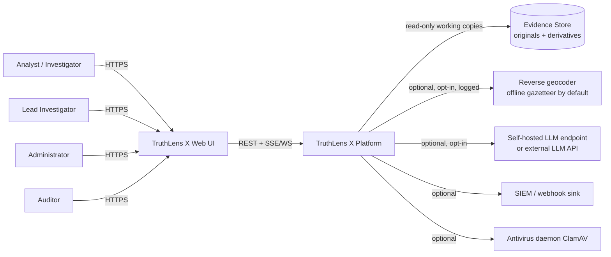
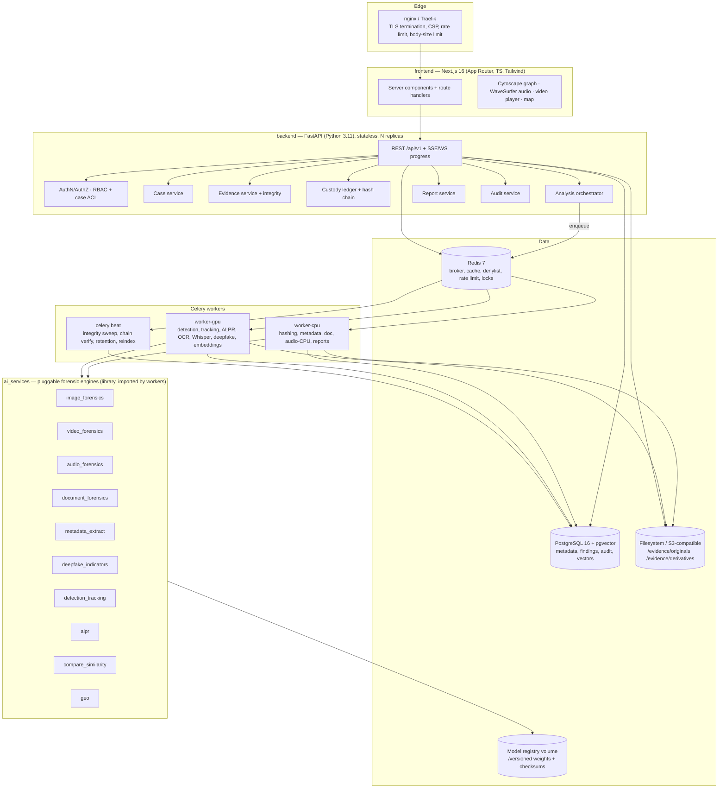
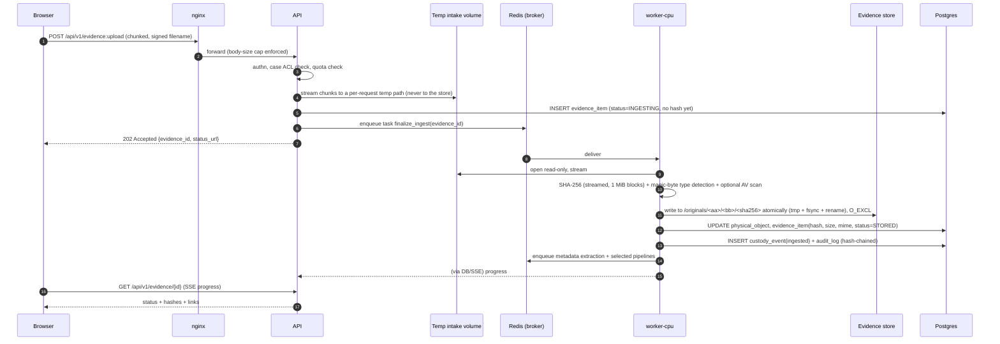
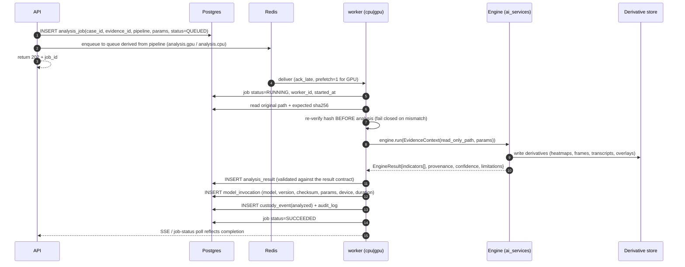

# TruthLens X — System Architecture

| | |
|---|---|
| **Document ID** | TLX-DOC-002 |
| **Version** | 0.1.0 (DRAFT — pending approval) |
| **Last updated** | 2026-11-10 |
| **Upstream** | [MASTER_PRD.md](./MASTER_PRD.md) |
| **Downstream** | [DATABASE_DESIGN.md](./DATABASE_DESIGN.md), [API_SPECIFICATION.md](./API_SPECIFICATION.md), [DEPLOYMENT_GUIDE.md](./DEPLOYMENT_GUIDE.md) |

---

## 1. Architecture principles

| # | Principle | Consequence in this design |
|---|---|---|
| AP-1 | **Originals are sacred** | Write-once content-addressed store; no code path mutates an original; all analysis reads through an immutable reader that re-verifies the hash. |
| AP-2 | **Derivatives are separate** | Distinct storage root, distinct DB tables, distinct lifecycle; derivatives are disposable and regenerable. |
| AP-3 | **Heavy work is asynchronous** | Anything > ~1 s goes to Celery. The API only enqueues and reports status. |
| AP-4 | **AI engines are pluggable and versioned** | Every engine implements a common interface, is registered in a model registry, and records its version/checksum on each invocation. Engines can be swapped or stubbed without touching business logic. |
| AP-5 | **Honest uncertainty is structural** | The result schema *requires* provenance, confidence, limitations, and verification fields. A result missing them cannot be persisted. |
| AP-6 | **Fail closed on security** | Missing secrets, failed hash verification, or missing case access deny the operation rather than degrading it. |
| AP-7 | **Boring technology at the core** | Postgres + Redis + FastAPI + Next.js. Novelty is confined to the analysis engines. |
| AP-8 | **Modular monolith, not microservices** | One backend package with strict internal module boundaries; separate *deployables* only where the runtime profile differs (API vs CPU worker vs GPU worker). |
| AP-9 | **Licence-aware dependency selection** | Copyleft (AGPL/GPL) components are isolated behind process or service boundaries and gated by explicit configuration flags. |

---

## 2. System context (C4 Level 1)



**Trust boundaries:** everything above the platform edge is untrusted input. External calls
(EXT1–EXT4) are egress-restricted, disabled by default where they carry data outside the host, and
individually logged.

---

## 3. Container view (C4 Level 2)



### 3.1 Container responsibilities

| Container | Image base | Responsibilities | Explicitly *not* responsible for |
|---|---|---|---|
| `frontend` | `node:22-alpine` (Next standalone output) | Presentation, client state, BFF-style proxying to the API with relative URLs, SSE/WS consumption. | No business rules, no direct DB access, no evidence bytes stored on the client. |
| `api` | `python:3.11-slim` | HTTP surface, auth, RBAC/ACL, validation, orchestration, transactional writes, SSE/WS. | No heavy computation, no model weights in the image (stays ~400 MB). |
| `worker-cpu` | `python:3.11-slim` + system libs (ffmpeg, exiftool, libgeos) | Hashing, ingest finalisation, metadata extraction, document forensics, CPU audio, report generation, graph/timeline materialisation. | No GPU code, no large model weights. |
| `worker-gpu` | `nvidia/cuda:12.x-runtime` + PyTorch | Detection, tracking, ALPR, OCR, Whisper, deepfake indicators, embeddings. | Never writes originals; only derivatives + DB rows. |
| `beat` | same as `worker-cpu` | Scheduled jobs: integrity sweep, hash-chain verification, retention, vector reindex, queue-health metrics. | No ad-hoc user work. |
| `postgres` | `pgvector/pgvector:pg16` | System of record. | No blob storage beyond small artifacts. |
| `redis` | **`redis:7.2-alpine`, digest-pinned** | Broker, cache, rate-limit counters, token denylist, distributed locks. | **Never** the sole store for anything that must survive — task *results* go to Postgres (the Celery result backend is PostgreSQL). ⚠️ **Redis ≤7.2 is BSD-3; Redis 8 moved to RSALv2/SSPLv1.** A CI gate fails the build on any `redis:8*` or `redis:7.3*` reference — see [ADR-0022](adr/ADR-0022-redis-7-2-pin.md). |
| `nginx` | `nginx:1.27-alpine` | TLS, security headers, request-size cap, coarse rate limiting, static asset caching. | No auth logic. |

**Why the API image excludes AI weights:** a PyTorch + weights image is routinely 5–10 GB. Keeping
it out of the API image means fast deploys, cheap horizontal scaling of the HTTP tier, and a small
attack surface for the internet-facing process. GPU capability is concentrated in one worker image.

---

## 4. Repository structure

```
TruthLens_X/
├── README.md                      # Project overview + docs index
├── LICENSE                        # To be chosen (see D-001/D-002)
├── .gitignore
├── .env.example                   # Every env var, documented, no real values
├── .github/
│   ├── workflows/
│   │   ├── ci-backend.yml         # lint, type, unit, integration, coverage
│   │   ├── ci-frontend.yml        # lint, type, vitest, build
│   │   ├── e2e.yml                # Playwright against compose stack
│   │   ├── security.yml           # bandit, pip-audit, npm audit, trivy, SBOM
│   │   └── release.yml            # build + push images, tagged
│   ├── CODEOWNERS
│   ├── PULL_REQUEST_TEMPLATE.md
│   └── ISSUE_TEMPLATE/
├── docs/                          # ← this documentation set (authoritative)
│   ├── MASTER_PRD.md
│   ├── SYSTEM_ARCHITECTURE.md
│   ├── DATABASE_DESIGN.md
│   ├── API_SPECIFICATION.md
│   ├── SECURITY_ARCHITECTURE.md
│   ├── IMPLEMENTATION_ROADMAP.md
│   ├── TESTING_STRATEGY.md
│   ├── DEPLOYMENT_GUIDE.md
│   ├── DECISIONS.md
│   ├── adr/                       # Accepted decision records, one file each
│   └── runbooks/                  # Operational procedures
├── backend/                       # FastAPI application (Python 3.11)
│   ├── pyproject.toml             # deps, ruff, mypy, pytest config
│   ├── alembic.ini
│   ├── migrations/                # Alembic versions/ (never hand-edited after merge)
│   ├── app/
│   │   ├── main.py                # app factory, middleware wiring, lifespan
│   │   ├── core/                  # config, security, logging, errors, deps, pagination, events
│   │   ├── db/                    # engine, session, base, transaction helpers
│   │   ├── models/                # SQLAlchemy ORM, one module per domain
│   │   ├── schemas/               # Pydantic v2 request/response models
│   │   ├── api/v1/                # routers, thin; one module per resource
│   │   ├── services/              # business logic (the only place rules live)
│   │   ├── repositories/          # data access; ORM queries isolated here
│   │   ├── tasks/                 # Celery app, task definitions, queue routing
│   │   ├── forensics/             # pipeline orchestration, result normalisation
│   │   └── reporting/             # ReportLab templates and layout components
│   └── tests/                     # unit/ integration/ contract/ fixtures/
├── ai_services/                   # Forensic engines (separate installable package)
│   ├── pyproject.toml             # heavy deps isolated here
│   ├── engines/
│   │   ├── base.py                # Engine ABC: name, version, checksum, run(ctx, input) -> Result
│   │   ├── registry.py            # discovery, version pinning, availability probing
│   │   ├── image_forensics/       # ela.py, dqt.py, copy_move.py, noise.py, phash.py
│   │   ├── video_forensics/       # probe.py, keyframes.py, temporal.py, shots.py
│   │   ├── audio_forensics/       # probe.py, asr.py, diarize.py, splice.py, vocoder_signals.py
│   │   ├── document_forensics/    # pdf_structure.py, revisions.py, xmp.py, ooxml.py, ocr.py
│   │   ├── metadata/              # exiftool_runner.py, normalise.py, provenance.py
│   │   ├── geo/                   # gps_parse.py, cluster.py, tracks.py, gazetteer.py
│   │   ├── deepfake/              # frequency.py, face_artifacts.py, temporal_flicker.py, aggregate.py
│   │   ├── detection/             # detector.py, tracker.py, alpr.py
│   │   ├── similarity/            # embeddings.py, features.py, compare.py
│   │   └── llm/                   # local_provider.py, external_provider.py, rag.py, guardrails.py
│   ├── models/                    # NOT in git — weights fetched/pinned by checksum (see §9)
│   ├── eval/                      # internal labelled evaluation sets + scoring harness
│   └── tests/
├── frontend/                      # Next.js 16 + TypeScript + Tailwind 4
│   ├── package.json
│   ├── next.config.ts
│   ├── tsconfig.json
│   ├── tailwind.config.ts
│   ├── playwright.config.ts
│   ├── vitest.config.ts
│   ├── src/
│   │   ├── app/                   # App Router: (auth)/, (dashboard)/case/[id]/...
│   │   ├── components/            # ui/ (primitives) + features/ (domain components)
│   │   ├── lib/                   # api client, auth, sse, formatters, constants
│   │   ├── hooks/                 # query hooks, websocket, keyboard nav
│   │   ├── stores/                # zustand stores
│   │   ├── types/                 # generated from OpenAPI (single source of truth)
│   │   └── styles/
│   ├── tests/unit/                # vitest
│   └── tests/e2e/                 # playwright specs
├── infra/
│   ├── docker/
│   │   ├── api.Dockerfile
│   │   ├── worker-cpu.Dockerfile
│   │   ├── worker-gpu.Dockerfile
│   │   ├── frontend.Dockerfile
│   │   └── entrypoints/
│   ├── compose/
│   │   ├── docker-compose.yml          # full stack
│   │   ├── docker-compose.dev.yml      # hot reload, no GPU
│   │   ├── docker-compose.gpu.yml      # GPU override
│   │   └── docker-compose.test.yml     # ephemeral stack for E2E
│   ├── nginx/                     # tls.conf, security-headers.conf, site.conf
│   ├── postgres/                  # initdb: roles, least-privilege grants, extensions
│   └── scripts/                   # backup.sh, restore.sh, genkeys.sh, verify-encrypted-mount.sh,
│                                  # fetch-models.sh, integrity-sweep.sh, seed-dev.sh
│   # NOTE: there is deliberately NO infra/k8s/ — ADR-0005 excludes Kubernetes from v1 entirely.
├── tools/
│   ├── fixtures/                  # synthetic evidence generator (tiny files, no big binaries in git)
│   ├── openapi/                   # export + type generation script
│   └── license-check/             # dependency licence policy gate
└── .dockerignore
```

### 4.1 Module boundary rules (enforced by `import-linter`)

1. `api/` (routers) may import `schemas/`, `services/`, `core/` — **never** `models/` internals or
   `repositories/` directly. Routers stay thin: validate → call service → map to schema.
2. `services/` may import `repositories/`, `models/`, `core/`, `tasks/` (to enqueue). Services own
   transactions and authorisation decisions.
3. `repositories/` may import `models/` only.
4. `forensics/` (orchestration) imports `services/` and `tasks/`; it does **not** import engine
   implementations directly — engines are resolved through the registry, and the registry is
   imported by *worker* code, never by the API process.
5. `ai_services/` must not import `backend/app`. The only coupling is the **result contract**
   (JSON schemas in `backend/app/forensics/contracts/`), so engines remain independently testable.
6. `core/` imports nothing from the application (no cycles).

Violations fail CI. This is what keeps the "modular architecture" rule true over time rather than
only at the start.

---

## 5. Key data flows

### 5.1 Evidence ingest (the integrity-critical path)



**Design details that matter:**

- **No original ever transits the API process memory in full.** Chunks are streamed to disk; hashing
  is streamed. This bounds RAM regardless of file size and prevents a 4 GB video from OOM-killing
  the API.
- **Atomic placement** via temp file + `fsync` + `rename` inside the store, with `O_EXCL` on the
  final path so a partial write can never masquerade as a complete object.
- **Deduplication** happens at the `physical_object` level: if the SHA-256 already exists, the new
  `evidence_item` references the existing physical object (with a per-case access grant). The
  original bytes are still never modified or moved.
- **Status is explicit** (`INGESTING → HASHING → STORED → FAILED`) so a crash between steps is
  visible and recoverable rather than silently producing an unhashed item.
- **Idempotency**: the upload endpoint accepts an `Idempotency-Key`; a replay returns the original
  result instead of creating a duplicate evidence item.

### 5.2 Analysis pipeline



**Guarantees:**

- Hash is re-verified at analysis time, not only at ingest — a silently corrupted file is caught
  before results are attributed to it.
- `ack_late=True` + `prefetch=1` on GPU queues: a crashed worker does not lose a task, and one
  long GPU task cannot starve behind a prefetched batch.
- The **result contract** is a versioned Pydantic/JSON schema. An engine that returns a result
  without provenance or limitations is rejected at persistence time — the honesty policy (AR-1..AR-8)
  is enforced by validation, not by reviewer vigilance.
- Retries: transient errors retry with exponential backoff (max 3); deterministic failures do not
  retry and go to a dead-letter table with the error class.

### 5.3 Report generation

Report jobs read a **manifest** (the exact set of entity IDs + their content hashes at request
time), so a report always describes a fixed, reproducible slice of the case even if the case later
changes. Output PDF is written to `derivatives/reports/`, hashed, and registered as an artifact.

---

## 6. Cross-cutting concerns

### 6.1 Configuration

`pydantic-settings` reads a single typed `Settings` object, validated at process start:

- **Fail closed**: any missing required secret aborts startup with a precise message naming the
  variable. No silent defaults for anything security-relevant (`SECRET_KEY`, `DB_PASSWORD`,
  `ENCRYPTION_KEY`, JWT keys).
- **Environment precedence**: process env > `.env` file (dev only) > defaults. `.env` is git-ignored;
  `.env.example` documents every variable with its default and risk.
- **Feature flags** for licence-sensitive components (`ENABLE_AGPL_PYMuPDF`, `ENABLE_ULTRALYTICS`)
  default to `false` so a default install is permissively licensed (see §8 and DECISIONS D-001..D-003).

### 6.2 Logging & observability

| Layer | Implementation |
|---|---|
| Structured app logs | JSON to stdout (`structlog`), fields: `ts`, `level`, `logger`, `request_id`, `actor_id`, `case_id`, `event`, `duration_ms`. PII redaction filter on by default. |
| Request tracing | ASGI middleware assigns/propagates `X-Request-ID`; the same ID is attached to the Celery task headers so an HTTP request can be followed into the worker. |
| Metrics | Prometheus client: HTTP latency histogram per route, queue depth per queue, task success/failure, ingest bytes/s, model inference latency per engine, integrity-sweep results. |
| Health | `/healthz` (liveness, no deps), `/readyz` (DB + Redis reachable, migrations current). |
| Tracing | OpenTelemetry hooks left in place but **not** wired to a collector in v1 (avoids a hard dependency); enabled by env flag. |
| Alerting (v1) | Log-based alert rules + `/metrics` thresholds documented in DEPLOYMENT_GUIDE; no bundled alertmanager. |

**Audit logs ≠ application logs.** Audit records are DB rows, hash-chained, user-visible, and
legally meaningful. Application logs are ephemeral, redacted, and operational. They are never mixed.

### 6.3 Error handling

- A single exception hierarchy (`TruthLensError` → `DomainError` / `IntegrityError` /
  `AuthorisationError` / `EngineError` / `ConfigurationError`).
- A global exception handler converts to **RFC 9457 `application/problem+json`** with a stable
  `type` URI, human `title`, `detail`, `instance`, and `request_id`. Stack traces never reach the
  client; they are logged server-side with the same `request_id`.
- Engine errors carry a machine-readable `error_class` (`MODEL_UNAVAILABLE`, `OOM`,
  `UNSUPPORTED_FORMAT`, `DECODE_FAILED`, `TIMEOUT`) so the UI can explain failures honestly instead
  of showing "no issues found".

### 6.4 Concurrency & locking

| Concern | Mechanism |
|---|---|
| Two workers analysing the same item | Redis distributed lock keyed by `evidence_id + pipeline`, with TTL and owner token. |
| Hash-chain integrity under concurrent writes | Chain append performed inside a `SERIALIZABLE` transaction on a per-case sequence, or via an advisory lock on `case_id`; retries on serialisation failure. |
| Duplicate ingest of identical bytes | `UNIQUE` on `physical_object.sha256` + `INSERT ... ON CONFLICT DO NOTHING` then re-select. |
| Idempotent task execution | Tasks carry an idempotency key derived from `(job_id, attempt)`; result writes are `ON CONFLICT` guarded. |
| DB session safety | One session per unit of work; no session shared across threads; explicit `commit()` boundaries in services only. |

---

## 7. Technology selection (with rationale)

### 7.1 Backend

| Concern | Choice | Rationale |
|---|---|---|
| Language | Python 3.11 (per requirement) | Ecosystem is the only realistic option for the required CV/ML/audio stack. 3.11 satisfies all pinned deps (Pillow 13 and PyMuPDF 2.1 both require ≥3.11). |
| Web | FastAPI 0.162.x | Async, Pydantic-native validation, first-class OpenAPI (which we generate TS types from). |
| Schemas | Pydantic v2 | Validation *is* the honesty-policy enforcement point. |
| ORM | SQLAlchemy 2.1 (typed, 2.0-style) | Mature, explicit, works with `SERIALIZABLE` and advisory locks. |
| Migrations | Alembic 1.20 | Required; autogenerate + mandatory human review; no `drop_table` without an ADR. |
| Tasks | Celery 5.7 + Redis broker | Required; mature routing, priorities, retries, `ack_late`. |
| Result backend | **PostgreSQL** (not Redis) | Task outcomes are evidentially significant; they must not evaporate with a Redis flush. |
| PDF | ReportLab 5.x (BSD) | Required; permissive licence; programmatic control over layout needed for evidentiary reports. |
| Media | ffmpeg/ffprobe binaries via subprocess | Container/stream probing and audio-track separation without re-encoding. |
| Password hashing | argon2-cffi (argon2id) + direct bcrypt for legacy verify | `passlib` 1.7.4 is unmaintained (last release 2020) and breaks against bcrypt ≥ 4.1 — avoided deliberately. |
| JWT | PyJWT (MIT) | Explicit, no framework magic. |

### 7.2 AI / forensic stack and **licence reality check**

Verified against PyPI/GitHub/npm on **2026-11-10**:

| Capability | Required-by-brief package | Verified licence | Verdict |
|---|---|---|---|
| Object detection (YOLO) | `ultralytics` 8.4.208 | **AGPL-3.0** | ⚠️ **Decision required (D-001)**. AGPL's §13 network clause reaches SaaS use. Permissive alternatives: `torchvision` (BSD) RetinaNet/FCOS/SSD, `mmdetection` (Apache-2.0), or Ultralytics *Enterprise* licence. |
| Tracking (ByteTrack) | `FoundationVision/ByteTrack` (moved from `ifzhang/ByteTrack`) | **MIT** (code); repo last pushed 2024-06 | ✅ Licence fine. ⚠️ Note: `ultralytics`' built-in `.track()` is AGPL — we will vendor/port the MIT association logic instead of importing ultralytics for tracking. |
| OCR | `easyocr` 1.7.2 | Apache-2.0 | ✅ |
| ASR | `openai-whisper` 20250625 (MIT) or `faster-whisper` 1.2.1 (MIT) | MIT | ✅ Prefer `faster-whisper` (CTranslate2) for CPU throughput; both supported behind one interface. |
| PDF | `PyMuPDF` 2.1 | **AGPL-3.0 or Artifex commercial** | ⚠️ **Decision required (D-002)**. Permissive/MPL alternatives that are *better suited to forensics*: `pikepdf` 10.18 (**MPL-2.0**, exposes QPDF structural detail — revisions, XRef, object streams), `pdfminer.six` (MIT), `pypdf` (BSD-3), `pdfplumber` (MIT). |
| Metadata | ExifTool binary (`exiftool/exiftool`) + `pyexiftool` wrapper | **GPL-3.0** binary; wrapper `GPLv3+/BSD` | ⚠️ **Decision required (D-003)**. Invoking ExifTool as a **separate process** (no linking, JSON output over a pipe) is the standard containment approach and does not make our code a derivative work under the usual reading — but bundling/distribution obligations still need your sign-off. Fallback: pure-Python EXIF/XMP readers (permissive) with reduced tag coverage. |
| CV primitives | `opencv-python-headless` 5.0.0.93 | Apache-2.0 | ✅ `headless` avoids GUI/X11 deps in containers. |
| Imaging | `Pillow` 13.0.0 | MIT-CMU | ✅ |
| DL framework | `torch` 2.15.0 / `torchvision` 0.29.2 | BSD-family (permissive set) | ✅ |
| Perceptual hashing | `imagehash` 4.3.2 | BSD-2 | ✅ |
| Vectors | `pgvector` | PostgreSQL Licence | ✅ |
| Graph analytics | `networkx` 3.7 | BSD-3 | ✅ |
| Report | `reportlab` 5.1.0 | BSD | ✅ |

**Default posture:** the shipped default configuration uses **only permissive/file-level-copyleft
components** (Apache/BSD/MIT/MPL). AGPL and GPL-binary components are available behind explicit
flags and documented in the licence notice, so *you* decide the distribution model rather than the
dependency graph deciding it for you. This is the single most important architectural decision
outstanding — see [DECISIONS.md](./DECISIONS.md).

### 7.3 Frontend

| Concern | Choice | Rationale |
|---|---|---|
| Framework | Next.js 16 (App Router), React 19, TypeScript 7 | Required; server components for fast case dashboards, standalone output for containers. |
| Styling | Tailwind CSS 4 | Required; design tokens in CSS variables for classification banners/theming. |
| Components | Radix UI primitives + in-repo `components/ui` (shadcn-style, vendored not installed) | Accessible by default (NFR-09); vendored so we control and can audit the code. |
| Data | TanStack Query 5 | Cache invalidation keyed to job status; SSE-driven invalidation. |
| Client state | Zustand 5 | Minimal; most state belongs in the server cache. |
| Graph | Cytoscape 3.34 (MIT) | Mature graph rendering, deterministic seeded layouts (GRAPH-06). |
| Audio | WaveSurfer.js 8 (BSD-3) | Waveform + spectrogram regions tied to transcript segments. |
| Tables | TanStack Table + virtualisation | Large evidence inventories. |
| Types | Generated from the backend OpenAPI document | Contract-first: frontend types cannot drift from the API. |
| Proxying | Next.js rewrites → API service | Browser only ever talks to same-origin relative URLs (required for the preview/proxy environment). |

---

## 8. Copyleft containment strategy

Because AGPL/GPL components may still be desired (ExifTool has no equal for tag coverage; PyMuPDF is
fast), the architecture contains them rather than pretending the issue away:

1. **Process isolation** — ExifTool and any AGPL tool are invoked as subprocesses with JSON/pipe
   IPC. No linking, no shared address space.
2. **Flag-gated imports** — `PyMuPDF`/`ultralytics` imports sit behind `if settings.ENABLE_*:`
   guards in dedicated adapter modules. Nothing else in the codebase may import them;
   `import-linter` enforces this.
3. **Adapter interface stability** — each capability has a permissive default implementation
   (pikepdf, torchvision) satisfying the same engine interface, so flipping a flag swaps the
   implementation without touching services or tests.
4. **Licence notice** — a generated `THIRD_PARTY_LICENSES.md` plus a CI licence-policy gate
   (`tools/license-check/`) that fails on any unexpected copyleft dependency entering the tree.
5. **Separate deployable (fallback)** — if legal review requires it, AGPL engines can be moved to
   their own container exposing an internal HTTP API, making them a separate program communicating
   at arm's length. The engine interface is already transport-agnostic, so this is a wiring change.

> This section is an engineering containment strategy, **not legal advice**. Confirm with counsel
> before distributing or hosting. Tracked as D-001/D-002/D-003.

---

## 9. Model management

```
Model registry (DB table: ai_models)
  ├── id, family, name, version, task, licence, source_url, weights_sha256, size_bytes,
  │   framework, framework_version, min_vram_mb, status (active|deprecated|retired), is_default
  └── measured_performance JSONB (TPR/FPR/precision/recall on the *internal* eval set, dataset name+hash)

Model weights (filesystem, read-only mount into GPU workers)
  /models/<family>/<version>/weights.bin + manifest.json (checksum, licence, card)
```

Rules:

- Weights are **never** in git. A pinned `models.lock.json` records family/version/sha256 and a
  fetch script retrieves them at build/first-run, verifying the checksum before use. Fetch fails
  closed if the checksum mismatches.
- Every invocation writes a `model_invocations` row (DF-08, AR-2). This is what makes results
  reproducible and defensible.
- Only one model version per pipeline is `is_default`; analysts may override per job, and the
  override is recorded.
- Deprecating a version does not delete it — historical results must remain interpretable against
  the model that produced them.
- **CI never downloads weights.** Tests use deterministic stub/fake engines and tiny synthetic
  fixtures (see TESTING_STRATEGY §5). A separate, explicitly-triggered "model smoke" workflow runs
  real inference.

---

## 10. Storage architecture

```
/evidence
├── originals/                 # WRITE-ONCE. Mounted read-write only into ingest workers.
│   └── <sha256[0:2]>/<sha256[2:4]>/<sha256>        # content-addressed, 2-level fanout
├── derivatives/               # Regenerable. Separate lifecycle & retention.
│   ├── thumbs/<evidence_id>/
│   ├── frames/<evidence_id>/<frame_index>_<pts>.jpg
│   ├── heatmaps/<evidence_id>/<pipeline>/
│   ├── transcripts/<evidence_id>/<model_version>.json
│   ├── overlays/<evidence_id>/<pipeline>/
│   ├── audio/<evidence_id>/extracted_track.wav
│   └── reports/<case_id>/<report_id>/v<n>.pdf
├── intake/                    # Transient upload landing zone, aggressively GC'd
└── quarantine/                # Rejected/failed/AV-flagged uploads (retained for review)
```

| Property | Mechanism |
|---|---|
| Write-once originals | Mount `originals/` **read-only** into every container except the ingest worker; application code exposes no write path; `O_EXCL` on creation; post-write `chmod 0440`. |
| Integrity | Whole-file SHA-256 at ingest, re-verified before analysis and on a scheduled sweep; mismatch = critical alert + item flagged `INTEGRITY_FAILED`. |
| Deduplication | `physical_object` (1) ← `evidence_item` (N); access is authorised per case, not per file. |
| Storage abstraction | `StorageBackend` interface with `filesystem` and `s3` implementations. v1 ships filesystem; S3 adapter included but disabled by default (D-005). |
| Capacity | Fanout avoids single-directory inode blowups at 1M+ items; quota tracked per case in DB and enforced pre-write. |
| Backups | `originals/` + Postgres WAL/base backups; restore tested on a schedule (SEC-06). |

**Explicit non-decision flagged for approval:** whether to add application-level envelope
encryption of originals (AES-256-GCM with per-object DEKs wrapped by a KMS/env KEK). It protects
against disk theft but adds a key-loss = evidence-loss failure mode. See **D-006**.

---

## 11. Deployment topology

**Phase 1 (v1 target): Docker Compose on a single Linux host.**

```
[clients] → nginx:443 → frontend:3000
                     ↘ api:8000 (1..N replicas)
        api ↔ postgres:5432 · redis:6379
        workers ↔ postgres · redis · /evidence · /models
        (optional) clamav:3310
```

Rationale: forensic deployments are frequently on-prem/air-gapped-sensitive; compose is auditable,
portable, and has no cluster control plane to secure. GPU support via the
`docker-compose.gpu.yml` override + NVIDIA Container Toolkit.

**Kubernetes is excluded from v1 entirely** ([ADR-0005](adr/ADR-0005-single-host-docker-compose-deployment.md)).
There is **no `infra/k8s/` directory and no Helm chart** — not scaffolded, not stubbed. Shipping an
empty scaffold would imply a delivery path that does not exist. A v2 migration to Kubernetes or a
multi-host split is a manifest-generation exercise rather than a redesign, because each service is
already defined per-container with explicit networks and volumes, and `StorageBackend`
([ADR-0011](adr/ADR-0011-filesystem-storage-backend-only.md)) already abstracts the filesystem. See
DEPLOYMENT_GUIDE §9 and BACKUP_RECOVERY §7.2.

**Sandbox/development note:** this workspace has no Docker daemon, so compose files will be
validated by CI (`docker compose config` + a full E2E stack) rather than locally during
development. Tracked as a delivery risk in IMPLEMENTATION_ROADMAP §7.

---

## 12. Architectural risks and mitigations

| # | Risk | Impact | Mitigation |
|---|---|---|---|
| R-1 | AGPL/GPL dependencies impose obligations the project cannot meet | Legal / distribution blocked | §8 containment + flags default off + licence CI gate + **explicit approval (D-001..D-003)** |
| R-2 | Deepfake/audio-authenticity claims over-trusted by users | Harmful false conclusions, liability | AR-1..AR-8 enforced in schema and UI; internal eval set; mandatory disclaimer text; no binary verdicts |
| R-3 | Model weights (multi-GB) leak into git or images | Repo bloat, slow CI, licence ambiguity | `models.lock.json` + read-only mount + `.gitignore` + CI size gate |
| R-4 | GPU worker OOM on long 4K video | Job loss, wedged queue | Frame-batch streaming, `prefetch=1`, per-task memory guard, `soft_time_limit`, OOM recorded as `error_class` |
| R-5 | Re-encoded social-media downloads arrive stripped of metadata | Forensic value reduced, users assume tampering | Detect and *report* stripping signals (META-04); never imply malicious intent from absence of metadata |
| R-6 | Audit/custody tables grow unbounded | Query degradation | Partitioning by month, archival policy, retention jobs (DATABASE_DESIGN §9) |
| R-7 | Hash-chain contention serialises writes | Ingest throughput drop | Per-case chaining scope + advisory locks + batched chain appends; measured in load test at M14 |
| R-8 | Single-host deployment = single point of failure | Availability | Documented honestly (NFR-03/NFR-04); backups + restore runbook; K8s/multi-node path documented |
| R-9 | Dependency churn (torch/OpenCV majors) breaks engines | Regression in forensic output | Upper-bounded pins, `models.lock.json`, golden-file tests on deterministic fixtures, Renovate-style digest PRs |
| R-10 | PII (faces, plates, GPS, transcripts) mishandled | Privacy/legal exposure | Least-privilege ACLs, fuzzing for lower roles, masking derivatives, retention limits, full read auditing (GEO-07, ALPR-07, NFR-12) |

---

*End of SYSTEM_ARCHITECTURE.md — v0.1.0 DRAFT. No code implementing this architecture exists yet.*
