# TruthLens X — Testing Strategy

| | |
|---|---|
| **Document ID** | TLX-DOC-007 |
| **Version** | 0.1.0 (DRAFT — pending approval) |
| **Last updated** | 2026-11-10 |
| **Tools** | pytest · pytest-asyncio · hypothesis · Vitest · React Testing Library · Playwright · k6/Locust · Trivy · pip-audit · bandit |
| **Governing rule** | *"Never mark a feature complete without testing it."* — enforced by the Definition of Done and by CI gates, not by intention. |

---

## 1. Why testing this product is unusual

TruthLens X has four properties that make ordinary testing insufficient:

1. **Outputs are probabilistic.** A detector's confidence is not "correct" or "incorrect" in the unit
   sense. We test *determinism*, *calibration*, *contract conformance*, and *behaviour on known
   fixtures*, not truth.
2. **Honesty is a functional requirement.** "The UI must not claim a deepfake is confirmed" is a
   testable property (string lint, schema checks, DB CHECK constraints), and we test it like any
   other requirement — see §7.4.
3. **Integrity must survive adversarial conditions.** Corruption, tampering, path traversal, hostile
   filenames, and zip bombs are *expected inputs*, not edge cases.
4. **Real models are multi-GB and often need a GPU.** CI must therefore run **without** weights and
   without a GPU, using stub engines — while a separate, explicitly-triggered workflow exercises the
   real ones.

Everything below is designed around those four facts.

---

## 2. Test pyramid

```
                    ┌───────────────────────────────┐
                    │  E2E (Playwright)  ~40 specs  │  journeys J1–J6, security headers, a11y
                    ├───────────────────────────────┤
                    │ Integration ~250              │  API↔DB↔Redis↔storage↔stub engines
                    ├───────────────────────────────┤
                    │ Engine / golden-file ~150     │  deterministic forensic outputs on fixtures
                    ├───────────────────────────────┤
                    │ Unit ~1200                    │  services, repositories, parsers, validators
                    └───────────────────────────────┘
```

| Layer | Scope | Speed budget | Real dependencies? |
|---|---|---|---|
| Unit | Pure logic: services, validators, canonicalisation, path helpers, formatters, state machines | < 60 s for the whole backend unit suite | None (DB/Redis/storage faked) |
| Engine / golden | Forensic engines against synthetic fixtures with known properties | < 3 min (CPU only, tiny fixtures, stub or tiny real models) | Fixture files only |
| Integration | Full request path through real Postgres + Redis + filesystem storage + stub engines | < 6 min | Yes — service containers |
| Contract | OpenAPI baseline diff, TS type generation, result-contract validation | < 30 s | No |
| E2E | Real browser against a full compose stack | < 15 min | Yes — full stack |
| Performance | Load and ingest throughput | on-demand + nightly | Yes |
| Security | Negative suite, header suite, scanner gates | < 5 min + scanners | Partial |

**Rule of thumb:** if a defect could be caught at a lower layer, it must be. E2E tests cover
*journeys*, not logic branches.

---

## 3. Repository test layout

```
backend/tests/
├── conftest.py                  # app fixture, db session, auth factories, storage tmp root
├── unit/
│   ├── core/                    # config fail-closed, logging redaction, errors, pagination, idempotency
│   ├── services/                # one file per service
│   ├── repositories/
│   ├── security/                # password hashing, jwt, refresh rotation, capability resolution
│   ├── custody/                 # canonical json, chain build/verify, tamper detection
│   └── forensics/contracts/     # result-contract validation (incl. rejection of dishonest results)
├── integration/
│   ├── api/                     # per-namespace route tests (auth, cases, evidence, jobs, results…)
│   ├── ingest/                  # streaming upload, dedup, large-file RSS, quarantine
│   ├── storage/                 # write-once, RO mounts, path containment, integrity sweep
│   ├── tasks/                   # celery eager + real-broker modes, retries, DLQ, locks
│   └── migrations/              # up/down/up, grants, triggers, seeds, alembic check
├── contract/
│   ├── test_openapi_baseline.py
│   └── test_route_authorisation_matrix.py   # ← the T-03 control
├── security/
│   ├── test_negative_matrix.py              # every forbidden action → specific deny code
│   ├── test_filename_attacks.py
│   ├── test_path_traversal.py
│   ├── test_secret_redaction.py             # canary secrets never appear in any output
│   └── test_string_lint_honesty.py          # ← the AR-1 control
├── fixtures/
│   ├── factories.py             # hypothesis-powered + explicit factories
│   └── media/                   # symlinks/copies of generated synthetic fixtures
└── performance/
    ├── test_ingest_throughput.py
    └── k6/                      # load scenarios

ai_services/tests/
├── unit/                        # engine-internal logic with stubbed models
├── golden/                      # fixture in → expected result JSON out (tolerance-checked)
├── determinism/                 # same input twice → identical output (seed & device controlled)
├── eval/                        # measurement harness tests (metrics math, dataset hashing)
└── fixtures/                    # generated synthetic media with ground-truth manifests

frontend/
├── tests/unit/                  # vitest + RTL: components, hooks, formatters, stores
├── tests/contract/              # generated types match mocked API responses
├── tests/a11y/                  # axe-core assertions on key screens
└── tests/e2e/                   # playwright specs (journeys J1–J6 + security + a11y)
```

---

## 4. Backend testing conventions

### 4.1 Fixtures & factories

- **DB:** a real PostgreSQL service container per test session; each test runs inside a transaction
  that is rolled back (`nested` savepoints for tests that must commit). Schema created once per
  session by `alembic upgrade head` — *not* `create_all()`, so migrations are exercised on every run.
- **Redis:** `fakeredis` for unit tests; a real Redis service container for integration tests
  (Celery/broker behaviour is too different to fake faithfully).
- **Storage:** a temporary directory implementing the `StorageBackend` interface, with an injected
  `simulate_readonly` flag so write-once violations can be asserted.
- **Engines:** `StubEngine` implementations registered under the same names as real engines,
  returning fixed, contract-valid results — plus `DishonestStubEngine` variants that omit provenance,
  confidence basis, limitations, or intervals, used to prove the validator rejects them.
- **Factories:** `factory`-style builders for users, cases, evidence, jobs, results with sensible
  defaults and explicit overrides; hypothesis strategies for adversarial strings, filenames, and
  numeric edge cases.

### 4.2 Async & Celery

- `pytest-asyncio` in strict mode; every async test declares its mode explicitly.
- Celery runs in `task_always_eager` for unit/integration of task *logic*, and against a **real
  broker** in a dedicated integration suite for delivery semantics (`ack_late`, retry, redelivery,
  DLQ, prefetch) — eager mode silently skips the behaviours most likely to break in production.
- Time: `freezegun`/`time-machine` for every timestamp-dependent test (custody chains, token expiry,
  rate limits, retention). No `sleep()` in tests except one deliberate redelivery test with a bounded wait.

### 4.3 Coverage & static analysis gates

| Gate | Threshold | Enforcement |
|---|---|---|
| Backend line coverage (new code) | ≥ 80% | `pytest --cov` + diff-cover against the PR base |
| Backend branch coverage (`app/core`, `app/services`) | ≥ 85% | same |
| `app/core/security`, `custody`, `forensics/contracts` | **100%** | these are the honesty/integrity controls |
| Frontend statement coverage (new code) | ≥ 70% | vitest coverage + diff-cover |
| Type checking | `mypy --strict` on `core/`, `schemas/`, `services/`; `--disallow-untyped-defs` elsewhere | CI blocking |
| Lint | `ruff` (incl. security rules), `eslint` with `no-dangerously-set-inner-html` as error | CI blocking |
| Mutation sampling | `mutmut` on `custody` + `security` packages, nightly (not per-PR — too slow) | reported, regressions block |

Coverage is a floor, not a target. A test that asserts nothing but inflates coverage is a defect;
PR review checks for it explicitly.

---

## 5. Synthetic evidence fixtures (no large binaries in git)

Real-world evidence files are large, licensed, and privacy-sensitive. **None are committed.** Instead,
`tools/fixtures/generate.py` produces tiny, deterministic, property-known media at test time:

| Fixture | Size | Ground truth encoded | Used by |
|---|---|---|---|
| `plain_camera.jpg` | ~40 KB | Synthetic EXIF (make/model/GPS/timestamps), camera-like DQT | M8, M9 |
| `resaved_photoshop.jpg` | ~40 KB | `Software=Adobe Photoshop`, altered DQT, double compression | M9 (DQT/ELA) |
| `spliced_region.jpg` | ~60 KB | A pasted region at a known bbox with different noise statistics | M9 (copy-move/splice) |
| `stripped.jpg` | ~30 KB | All metadata removed (messaging-platform simulation) | M8 (stripping signals) |
| `gps_conflict.jpg` | ~40 KB | EXIF GPS disagrees with XMP GPS; timestamps differ by seconds | M8, M16 (conflict groups) |
| `hostile_names/` | tiny | Filenames: `../../etc/passwd`, NUL bytes, RTL overrides, 4 KB names, emoji, CRLF | M5 (security) |
| `multi_revision.pdf` | ~30 KB | Three incremental saves; visible text differs per revision; changed objects known | M10 |
| `scanned.pdf` | ~50 KB | Image-only pages with known rendered text | M10 (OCR) |
| `with_attachment.pdf` | ~40 KB | Embedded file with known hash | M10 (child evidence) |
| `form_js.pdf` | ~30 KB | Form fields, annotations, a benign JS action | M10 (inventory) |
| `sample.docx` | ~20 KB | Known `docProps`, revision IDs, hidden text, ZIP entry order | M10 (OOXML) |
| `tone_1k.wav` | ~100 KB | 1 kHz sine, exact sample rate/duration | M11 baseline |
| `spliced.wav` | ~200 KB | Two segments joined at a known millisecond offset | M11 (change-point) |
| `clipped.wav` | ~100 KB | Hard clipping at known sample indices | M11 |
| `lowbitrate.mp3` | ~100 KB | Spectral cut-off at a known frequency | M11 (bandwidth) |
| `speech_short.wav` | ~200 KB | Synthesised speech-like signal for deterministic ASR stubbing | M11 |
| `clip_3s.mp4` | ~300 KB | 3 s, known fps/frames, one duplicated frame at a known index, one scene cut | M12 |
| `clip_objects.mp4` | ~600 KB | Synthetic moving rectangles with known trajectories and a known "plate-like" region | M13 (tracking/ALPR) |
| `zipbomb.zip`, `slip.zip` | tiny | Member-count/size bomb; `../` traversal members | M10, security |
| `corrupt_tail.jpg` | ~40 KB | Valid header, truncated body | decode-failure path |

Each generator records a **manifest** (`fixture_name → ground_truth JSON`) that golden tests assert
against. Generators are seeded and version-pinned so the same fixture bytes are produced everywhere;
the manifest includes each fixture's SHA-256.

**Golden-file policy:** expected outputs are stored as JSON with explicit numeric tolerances
(e.g. `abs_diff ≤ 0.01`, `bbox IoU ≥ 0.9`) and a `generated_by` engine version. Regenerating
goldens requires a PR label (`regenerate-goldens`) and a stated reason — this prevents silently
blessing a regression.

---

## 6. Forensic engine testing

| Concern | Approach |
|---|---|
| **Determinism** | Same fixture + same params + fixed seed + CPU device → byte-identical result JSON. Asserted for every engine. GPU paths assert equality within tolerance and record `deterministic=false` honestly. |
| **Contract conformance** | Every engine result validates against the result contract: provenance present, limitations code present, any score has an interval, any confidence has a basis. Property-based tests generate adversarial engine outputs. |
| **Ground-truth localisation** | For engines that produce regions (ELA, splice, copy-move, detection, ALPR, change-points), assert IoU / offset against the fixture manifest — not just "a result was returned". |
| **Negative honesty** | A *clean, authentic* fixture must produce low indicators. If it produces high indicators, either the engine is miscalibrated or the fixture is wrong — both are bugs. This test exists to stop false-positive inflation. |
| **Failure paths** | Corrupt/truncated/unsupported inputs → `error_class` set, `failed` status, no fabricated result. Missing model weights → `MODEL_UNAVAILABLE`, never a silent empty result. |
| **Resource bounds** | Large-fixture tests assert peak RSS bounds (streaming behaviour) and time limits. |
| **Version pinning** | Engine + library versions are captured in `model_invocations`; a test asserts the recorded versions match the installed ones (catches silent dependency drift). |
| **Real-model smoke** | A **manually triggered** GitHub workflow (`model-smoke.yml`, never on PR) downloads pinned weights, verifies checksums, runs each engine on 2–3 fixtures, and compares against recorded reference outputs. Its results are attached to the release checklist. |

### 6.1 Evaluation harness (AR-6)

`ai_services/eval/` holds a small labelled set we curate ourselves (synthetic where possible, to
avoid licensing/privacy problems). The harness computes TPR/FPR/precision/recall/F1 with confidence
intervals, records the dataset SHA-256 and sample count, and writes to `ai_models.measured_performance`.

Tests on the harness itself verify: metric math against hand-computed values, interval computation,
and that **no vendor-reported figure can enter the UI** (the display layer reads only
`measured_performance`; a test asserts there is no code path to any hardcoded accuracy string).

---

## 7. Security & honesty testing (the controls that matter most)

### 7.1 Route authorisation matrix test *(kills T-03 permanently)*

```python
# backend/tests/contract/test_route_authorisation_matrix.py  (design sketch)
EXPECTED = {("POST", "/api/v1/cases/{case_id}/results/{result_id}:verify"): {"can_verify_findings"}, ...}

def test_every_route_declares_expected_authorisation(openapi_doc, expected_matrix):
    for path, methods in openapi_doc["paths"].items():
        for method, op in methods.items():
            actual = resolve_required_capabilities(op)      # from x-capability + security scheme
            assert actual == expected_matrix[(method, path)], f"{method} {path}"
```

Any new route without a declared capability **fails CI**. This is the single highest-value test in
the suite: it makes "forgot the ACL check on one endpoint" structurally impossible to merge.

### 7.2 Negative matrix test

A table of `(actor, action, expected_status, expected_error_code)` covering every cell of the
capability matrix — including the subtle ones: admin trying to set verification status (forbidden),
admin trying to read originals of a case they are not a member of (break-glass required), a user in a
closed case trying to write, an expired time-bounded membership, an `auditor` requesting content.
Each case asserts the *specific* error code, not just `403`.

### 7.3 Tamper-evidence tests

- Flip one byte in a stored original → integrity sweep and pre-analysis verification both detect it.
- Modify any field of any `custody_events`/`audit_logs` row via a raw connection → chain verification
  reports `valid=false` and names `broken_at`.
- Attempt `DELETE FROM audit_logs` as `tlx_app` → raises (grants revoked) — asserted in a migration test.
- Attempt `UPDATE physical_objects` → trigger raises.
- Truncate a chain, re-append → detection.

### 7.4 Honesty string-lint test *(kills AR-1 violations)*

Scans every user-visible string source (frontend components/constants, report templates, engine
`summary`/`interpretation` builders, limitation statements) for forbidden phrasing:

```
FORBIDDEN = [r"\bis a deepfake\b", r"\bconfirmed fake\b", r"\bproven authentic\b",
             r"\bguilty\b", r"\b100% accurate\b", r"\bguaranteed detection\b",
             r"\bverified as authentic\b", r"\bdefinitive(ly)? (fake|real)\b"]
ALLOWED_CONTEXTS = {"human_verification_labels", "legal_disclaimer_quotations"}
```

Plus positive assertions: every deepfake/ELA/ALPR/ASR result template **contains** its limitation
text and the indicator framing. Failing this test blocks the merge — overclaiming is treated as a
severity-1 defect, on par with a security hole.

### 7.5 Secret-redaction test

Canary values are injected into `Settings` (`SECRET_KEY=CANARY-SECRET-…`, DB password, a fake
provider key). Then: trigger validation errors, engine failures, 500s, generate a report, run an
analysis, dump logs, and hit `/admin/settings`. Assert no canary appears in any captured output —
logs, responses, DB rows, PDF text (extracted with a PDF text parser), or task results.

### 7.6 Header & CSP suite (Playwright)

Asserts every response carries the required security headers, that inline script execution is blocked
by CSP, that `frame-ancestors` prevents embedding, and that cookies have the expected flags. A
deliberately weakened configuration must fail this suite (verified once during M20).

---

## 8. Frontend testing

| Layer | Tool | Coverage |
|---|---|---|
| Unit | Vitest + React Testing Library | Formatters (timestamps with precision/timezones, hashes, confidence display), stores, hooks, capability guards, pagination/cursor logic, SSE event reducer |
| Component | Vitest + RTL | Verification action dialog (notes mandatory on confirm/reject), uploader (chunk retry, hash display), metadata inspector (provenance badges), comparison workspace, graph filters, timeline conflict-group rendering |
| Visual/regression | Playwright screenshots on 4 key screens | Threshold-based diff; goldens regenerated only with a labelled PR |
| Contract | Generated TS types + MSW mocks from the OpenAPI examples | A response shape change without regeneration fails the build |
| Accessibility | `@axe-core/playwright` on every journey screen | WCAG 2.1 AA violations = failures; keyboard-only traversal of graph and timeline is an explicit spec |
| A11y-specific | Manual + automated | Colour-blind-safe heatmap palettes asserted via contrast checks; screen-reader labels on indicator cards |

**Honesty-specific frontend tests (unique to this product):**

- An unverified finding renders with the unverified treatment and the verification CTA.
- A deepfake advisory renders the disclaimer text even when the score is low.
- A failed analysis renders "analysis failed — no conclusion available" and **never** "no issues found".
- Confidence is rendered with its basis; a result with `confidence: null` renders "not applicable"
  rather than a fabricated percentage.
- Assistant answers without citations render the "not supported by case data" state.

---

## 9. End-to-end tests (Playwright)

Run against `docker-compose.test.yml` with seeded data and stub engines (fast, deterministic).

| Spec | Journey | Key assertions |
|---|---|---|
| `j1-ingest.spec.ts` | PRD J1 | Upload 12 items → hashes match an independent computation → dedup on identical bytes → downloaded bytes identical → custody `ingested` events present |
| `j2-analyse.spec.ts` | PRD J2 | Launch pipelines → SSE progress monotonic → results show provenance/confidence/limitations → a deliberately failed job shows `failed` + retry works |
| `j3-verify.spec.ts` | PRD J3 | Confirm 3 / reject 1 (notes mandatory) / leave 5 → statuses persist → each change appears in custody + audit → actor attribution correct |
| `j4-correlate.spec.ts` | PRD J4 | Comparison stores method+version+score+interpretation → inferred graph edge visible → promotion records the actor |
| `j5-report.spec.ts` | PRD J5 | Generate report → contains hashes, verification table, limitations → PDF hash recorded → regenerate from same manifest → equivalent output |
| `j6-audit.spec.ts` | PRD J6 | Filter by evidence → export → chain verify `valid` → export event itself logged → no audit mutation endpoint exists (404 assertions) |
| `security.spec.ts` | — | Cross-case UUID guess → 404; expired session → 401 + redirect; rate limit → 429 with `Retry-After`; headers/CSP present |
| `a11y.spec.ts` | — | Keyboard-only completion of J3; axe violations = 0 on all journey screens |

**E2E discipline:** no test depends on wall-clock timing beyond bounded waits; every test seeds its
own data through the API (no shared mutable fixtures); tests run in parallel workers with isolated
cases; a failure produces a trace, screenshot, video, and the API/worker logs as CI artefacts.

---

## 10. Performance & scale testing

| Test | Target | Method |
|---|---|---|
| Ingest throughput | ≥ 50 MB/s per worker (NFR-01) | k6/scripted client streaming a 1 GiB synthetic file; measure hash-bound throughput; assert API peak RSS < 256 MB |
| API latency | p95 < 300 ms metadata reads; < 800 ms graph/timeline at 50k events (NFR-01) | k6 mixed scenario, 100 concurrent users, against a seeded DB at target volume |
| Seeded-scale DB | 1M evidence rows, 50k timeline events, 5M detections | Synthetic seed script; verify query plans use intended indexes (`EXPLAIN ANALYZE` assertions in a perf test) |
| Integrity sweep at scale | 10k objects swept within a documented window | Timed job run; results recorded in the release checklist |
| Queue behaviour | GPU queue does not starve CPU queue; DLQ depth bounded | Synthetic load with stub tasks of controlled duration |
| Chain append contention | 8 parallel writers, no gaps/duplicates, throughput recorded | Concurrency integration test (also a correctness test) |
| Frontend | Case dashboard TTI < 2 s on seeded 100k-item case; graph renders 5k nodes < 3 s | Playwright + `web-vitals` capture |

Performance regressions > 10% on any tracked metric fail the nightly job and are reported; they do
not block feature PRs (to avoid flakiness-driven churn) but they do block a release.

---

## 11. CI/CD pipeline

```mermaid
flowchart LR
  PR[Pull request] --> L1[lint + type + fmt]
  L1 --> L2[unit: backend · frontend · engines]
  L2 --> L3[contract: openapi baseline · route-authz matrix · types]
  L3 --> L4[integration: postgres+redis service containers]
  L4 --> L5[security: bandit · pip-audit · npm audit · gitleaks · licence gate]
  L5 --> L6[coverage diff gate ≥80% new code]
  L6 --> G{all green?}
  G -- no --> F[fail + artefacts]
  G -- yes --> M[merge allowed]
  M --> N1[build images · trivy · SBOM · push by digest]
  N1 --> N2[e2e: compose.test stack · Playwright]
  N2 --> N3[nightly: mutation sampling · perf · model-smoke manual]
```



| Workflow | Trigger | Blocking? |
|---|---|---|
| `ci-backend.yml` | PR, push to the working branch | Yes |
| `ci-frontend.yml` | PR, push | Yes |
| `security.yml` | PR, push, daily | Yes (critical/high without an accepted-risk record) |
| `e2e.yml` | merge to the working branch, nightly | Yes on merge |
| `model-smoke.yml` | **manual only** (`workflow_dispatch`) | No — but its report is required for a release |
| `perf.yml` | nightly + pre-release | No — regressions reported; block release |
| `release.yml` | tag `v*` | Yes — builds digest-pinned images + release notes |

CI hygiene: dependency caching (pip/pnpm/Docker layers), service containers for Postgres/Redis,
`--frozen-lockfile` installs, artefacts on failure (logs, traces, coverage, junit XML), no test
depends on network egress beyond the package registries, and the full matrix must complete in < 20 min
(otherwise people stop waiting for it, which is how gates die).

---

## 12. Test data, privacy & ethics rules

1. **No real personal data in tests, ever.** All fixtures are synthetic or self-generated. No real
   faces, plates, GPS traces of real people, real case material, or real documents.
2. **No copyrighted media.** Synthetic generation avoids third-party licensing entirely.
3. **No real credentials**, including "test" credentials that resemble production ones. Test secrets
   are obvious canaries (and the redaction test depends on that).
4. **Deepfake fixtures must be unambiguous.** Synthetic face/media fixtures are generated from
   clearly artificial sources so no real person's likeness is used, and every such fixture is labelled
   in its manifest as synthetic-test-data.
5. **Plate fixtures** use formats marked `is_example=true` and values that cannot correspond to a real
   registered plate where avoidable.
6. Test databases are destroyed after each CI run; no evidence bytes persist in artefacts (only
   hashes, logs, and traces).

---

## 13. Quality gates summary (what blocks a merge)

| Gate | Threshold |
|---|---|
| Lint/format/type | zero errors |
| Unit + integration + engine tests | all pass, zero skipped without a linked issue |
| Route authorisation matrix | 100% of routes declare expected capabilities |
| Honesty string lint | zero forbidden phrases; required limitation text present |
| Secret redaction | zero canary appearances |
| Tamper-evidence suite | all detections fire |
| New-code coverage | ≥ 80% backend / ≥ 70% frontend; 100% for `core/security`, `custody`, `forensics/contracts` |
| Contract | OpenAPI baseline diff clean or intentionally updated in the same PR; TS types regenerated |
| Migrations | up → down → up clean; `alembic check` no drift |
| Dependency/licence | no new critical vulnerability; no unexpected copyleft in the default set |
| Docs | affected spec updated; roadmap status board updated |

---

*End of TESTING_STRATEGY.md — v0.1.0 DRAFT. No tests exist yet; the harness itself is delivered in M1.*
